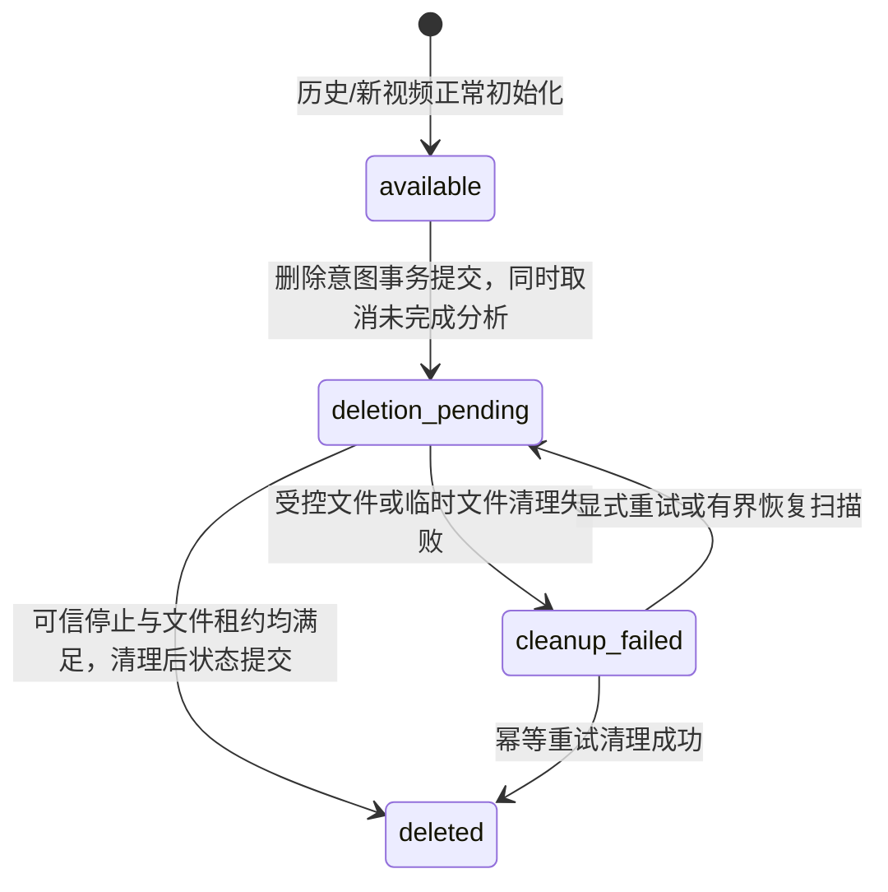

# 第 6 窗口：原视频与笔记分离

## 目标与边界

允许用户永久删除原视频文件并继续阅读删除生效前已经合法持久化的转写、章节、知识要点、引用原文和时间定位。删除意图的事务提交是不可撤销的生效点：此后不创建或领取分析任务，不续接、不恢复、不写入检查点、不发布新总结，也不接受新的媒体打开。保留既有可信停止边界、execution 全局占位、三类预算及共享模型冷却语义。

本窗口不提供媒体恢复、重新上传关联、笔记编辑或问答，不变更 ACK、执行停止证明和模型调用策略，不承担第 7 窗口整体验收与展示材料。媒体删除待处理或失败时笔记可读；整条记录删除仍移除全部关联数据。

## 持久化状态

`videos.status` 继续表达整条记录状态；新增 `videos.media_status` 独立表达原媒体生命周期：

`AnalysisTask.notes_attempt_id` 在媒体删除生效时固定笔记读取版本：优先使用已发布总结所引用 attempt；否则选取已持久化成功转写最多的版本，并以当前版本和较新版本作为确定性平局规则。已发布总结的 `attempt_id`、引用载荷和原文不重写。转写 API 独立判定完整性；部分转写保持部分状态，缺少已发布总结时不合成成功总结。

删除短事务以视频行为首锁，再锁 task、attempt、delivery 和未完成 summary request。它清除排队、投递等待、模型等待和恢复时点，将未完成分析终结并递增 delivery operation generation；预算计数、stop 确认和其他任务的冷却行不变。已发布 `AnalysisSummary` 保持原样。删除后错误 attempt 不再允许人工或自动创建后续 attempt。

## 清理与并发

生效事务先于文件系统操作。恢复操作先检查所有 attempt 的可信停止证据，再获取 upload inode 文件租约；持租约后重新锁定并核对视频及所有 attempt，完成本 attempt 临时目录和原媒体清理。DB 行锁只覆盖资格复核和状态提交，不贯穿文件流。文件不存在可幂等完成路径清理，但不会用文件缺失推断 execution 停止。状态提交失败时仍保留意图；后续重试可从文件不存在状态完成。稳定 inode 租约标记不删除。

同一 upload 租约串行化媒体清理、整条记录清理和上传交接；两种清理模式显式区分，媒体清理只处理原媒体及 attempt 临时目录，不删除笔记、task、attempt 或总结。整条记录删除仍沿用 `DELETE /videos/{id}`，并可接续媒体清理失败或媒体已删除的记录。恢复复用 API 启动恢复及现有单实例维护周期，扫描有界（每次最多 8 条），不增加调度器。

媒体 GET、HEAD 与 Range 共用入口：在视频行锁事务内检查 `media_status=available`，并在释放行锁前打开文件句柄。删除提交后新请求均返回 410；已打开流可以继续，流式响应不持有 DB 行锁，客户端断开时关闭文件句柄。

## API 与页面

沿用现有 Cookie、CSRF、Origin、用户归属及整体删除约束：

| 接口 | 契约 |
| --- | --- |
| `DELETE /videos/{id}/media` | 提交删除意图并尝试清理；完成返回 200，仍待可信停止或清理则返回 202。 |
| `GET /videos/{id}/media-deletion` | 所有者读取状态、稳定清理错误、待停止/待清理 attempt 列表；`private, no-store`。 |
| `POST /videos/{id}/media-deletion/retry` | 仅重试已请求的媒体清理，不创建 attempt、不调用模型、不变更预算。 |
| `GET|HEAD /videos/{id}/content` | 媒体可用时打开文件；删除意图后返回 410，包括 Range 请求。 |
| `DELETE /videos/{id}` | 保持原有整条记录删除语义和客户端调用方兼容。 |

媒体状态 `available`、`deletion_pending`、`cleanup_failed`、`deleted` 与整体视频状态独立。页面提供分别确认“删除原视频，保留笔记”和“删除整条记录”，展示等待停止、处理中、清理失败/重试、已删除状态。媒体一旦关闭，卸载播放器、清空 seek 引用，停止对总结引用和转写时间戳提供回看动作，但保留引用文字和时间信息；库列表与详情页短周期刷新媒体状态以同步其他标签页更新。

## 迁移

Alembic `d42f6c8a901e` 从 `7c2a91e5b04d` 增加独立媒体状态、清理错误码、笔记 attempt 固定列及其延迟外键。迁移保留 task/attempt 历史身份、冻结配置、预算、执行/投递记录、转写和总结载荷。正常 `ready` 视频设为 `available`；带媒体清理意图的既有失败清理映射为 `cleanup_failed`；既有整条删除态不被重新开放。遇到旧状态枚举外的值时迁移失败关闭，不伪造删除历史。

## 验收入口与交接

- 直接行为及事务测试：`tests/test_media_deletion.py`。
- 前端交互：`frontend/e2e/stage6-media-deletion.spec.ts`。
- 隔离运行器：`scripts/stage2/run-final-stage6-acceptance.ps1`；仅创建带唯一项目名、唯一数据目录与独立 Postgres/Redis/本地模型替身的 Compose 项目，并为每次 Playwright 使用新产物目录。
- 命令、历史数据预检、真实部署状态、实测结果和剩余缺口见同目录 `validation.md`。
- 最终时间线、长样片及整体验收/展示仍留给第 7 窗口；不能用本窗口隔离测试替代第 0 窗口尚未验证的 20 分钟真实模型、计费及存储峰值事项。
