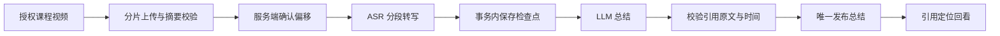

# 课迹：公开脱敏展示材料

本页只介绍可公开的流程与边界，不含用户课程画面、原文、模型返回、账户凭据、真实用户/记录 ID 或历史业务截图。下面的 timeline 仅是产品结构示意，不是某条真实任务的时间戳。

## 一条课程视频如何成为可核验笔记

播放器和接口只向所属用户开放。执行时间线记录阶段、时间、稳定错误码和安全 request reference；任务状态表仍是当前状态的事实来源。未验证总结不发布，已发布摘要可逐条回看核验。

## 脱敏时间线示意

| 顺序 | 用户可见动作 | 保存内容 |
| --- | --- | --- |
| 1 | 上传完成 | 上传状态与关联标识 |
| 2 | 分析领取 | task/attempt、阶段 |
| 3 | 转写片段保存 | 检查点编号和阶段，不保存额外事件原文 |
| 4 | 总结响应校验 | 稳定结果/错误分类与请求引用 |
| 5 | 总结发布 | 唯一发布动作及关联标识 |
| 6 | 媒体清理 | 清理状态；笔记保留或整条删除 |

## 事实与限制

- 当前媒体处理只分析语音，不识别画面、代码或图表。
- 工程校验能检查引用源文本和时间范围，不能证明总结语义完整或课程关键知识点覆盖全面。
- 隔离故障展示使用本地模型替身；真实样片展示与供应商用量/计费证据是另一类证据。
- 公开展示不嵌入实际课堂截图、转写、模型输出或账户页面。
