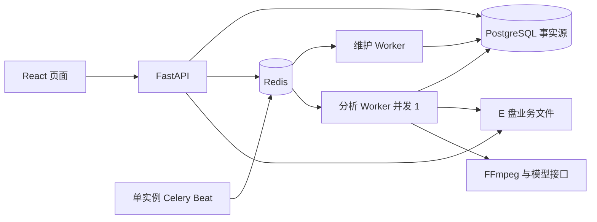

# 课迹：最终版技术方案

> 状态：设计已形成，最终版增量功能尚未实施或验收；MVP 已通过最终验收。
> 更新日期：2026-10-03。
> 范围依据：[最终版产品设计](../product/final.md)。已有能力与历史取舍见 [MVP 技术方案](mvp.md) 和 [第六窗口验收记录](../../.scratch/mvp-stage-6/validation.md)。产品行为及验收范围以最终版产品设计为准。

## 1. 目标、边界与实施原则

在已完成的本地 MVP 上交付四项增量能力：分片续传、受控自动恢复、单独删除原视频并保留笔记，以及可复现的执行过程。先以 `video\` 中新增的约 17 分钟授权样片核验媒体、模型和资源基线，再分阶段实施。每阶段保持现有转写、总结、鉴权与整条记录删除闭环可用。

最终版沿用语音分析范围和片段级引用，不扩展画面理解、课程问答、通用转码、移动端或公开部署。引用校验仍只证明来源与定位，不证明语义准确性或知识点覆盖。模型调用可能在结果提交前中断而重复；系统保证检查点与总结的发布条件，不承诺外部请求恰好执行一次。

| 不可妥协项 | 技术含义 |
| --- | --- |
| 单任务并发 | 全部署最多一个视频分析执行者；维护任务不能领取分析任务。其他视频任务可提交并排队。 |
| 接管安全 | 旧执行者停止未确认时禁止自动接管、清理其工作目录；心跳超时或数据库锁释放本身不是停止证明。 |
| 结果完整性 | 仅完整转写和合法引用可发布唯一总结；旧 attempt、迟到消息和写回不得覆盖结果。 |
| 数据位置 | 视频、数据库、上传临时文件及处理文件留在 `E:\VideoClip\data`；授权样片在 `video\`，均不进入 Git。 |
| 容量策略 | 不设置单文件字节数或业务目录运行期硬上限；记录实际占用，写入失败须报错并安全清理。Docker 新增占用仍按 7 GiB 条件评估。 |
| 模型与费用 | 优先沿用已验证模型；不自动切换付费模型，实际可用性与计费从账户核对。 |

## 2. 现状与技术栈选择

MVP 已具备 FastAPI 原始流上传、E 盘受控存储与文件租约，PostgreSQL 中的视频、task、attempt、投递、执行、片段检查点和总结记录，Redis/Celery 单并发 Worker，FFmpeg 时间轴校验，以及 React/TypeScript 页面。真实浏览器使用 368.6 秒授权样本完成 13 段 ASR、总结、人工恢复和引用回看；约 17 分钟新样片及最终版功能尚未验收。

| 层次 | 最终版选择 | 新增或沿用的职责 |
| --- | --- | --- |
| API 与业务 | 现有 Python、FastAPI、Pydantic | 增量上传协议、媒体删除和统一的状态查询；继续由业务操作管理事务。 |
| 持久化 | 现有 PostgreSQL、SQLAlchemy、Alembic | 扩展上传、到期恢复、媒体状态和执行事件；数据库仍是事实源。 |
| 异步执行 | 现有 Redis、Celery | 分析 Worker 保持并发 1；增加单实例 Celery Beat 与只消费维护队列的轻量 Worker。 |
| 媒体与模型 | 现有 FFmpeg、ffprobe、ASR/LLM 适配器 | 保持冻结配置、片段指纹与总结校验；长样本验证后才调整新任务的配置。 |
| 浏览器 | 现有 React、TypeScript、Vite、XMLHttpRequest | `Blob.slice()` 分片、续传进度、等待/恢复时间线及无视频笔记页面。 |
| 文件摘要 | Python `hashlib`；浏览器增量 SHA-256 使用 `@noble/hashes` | 分块计算，不把整段大文件读入浏览器内存；安装时锁定经验证版本。 |
| 本地运行与验证 | 现有 Docker Compose、pytest、Vitest、Playwright | 新组件复用后端镜像；补迁移、故障与长视频真实浏览器验收。 |

Celery Beat 只发起周期协调，不决定分析任务是否可接管；维护 Worker 读取 PostgreSQL 并执行有界的投递、清理和恢复判定。分析队列与维护队列分开，维护过程在长视频分析或分析 Worker 崩溃时仍可运行。Beat 在一个部署中只运行一个实例，其调度文件放在 E 盘项目数据目录。不要在 API 与分析 Worker 内再分别启动调度循环。

新增组件使用现有模块化单体的业务操作与数据模型，不另建服务数据库。具体可执行版本以依赖锁和 Compose 验证为准。浏览器增量 SHA-256 的依据见 [@noble/hashes 官方仓库](https://github.com/paulmillr/noble-hashes)；浏览器原生 `SubtleCrypto.digest()` 不支持流式输入，见 [MDN 说明](https://developer.mozilla.org/en-US/docs/Web/API/SubtleCrypto/digest)。

## 3. 第一关：长视频与环境基线

在开发增量功能前，对新增授权样片读取实际字节数、SHA-256、媒体流、时长、起始时间、时间轴映射与浏览器可播放性，确认符合已支持的媒体规则。先检查 E 盘可用空间，记录原视频、音频中间文件、PostgreSQL/Redis、容器层及日志的处理前后与峰值占用。

使用冻结配置测试真实 ASR/LLM，记录片段数、耗时、限流、总结输出长度及合法引用。MVP 的 6 分钟样本不能代替本关。现有 task 级总结请求总上限为 3；若新样片在该预算内无法产生合法总结，先分析上下文与输出限制，再为**新建任务**验证配置或提示词调整。已有 attempt 继续使用其冻结快照，不拼接不同版本的检查点，也不静默使用付费模型或截断转写。

本关记录账户侧模型可用性及计费信息，区分本地零费率配置与实际账单事实。20 分钟时长边界另行验证，不能把约 17 分钟实测称作完整 20 分钟模型验收。

## 4. 分片续传

### 4.1 协议与持久化

选择 **8 MiB** 为默认分片大小，最后一片可更小；这是传输单元，不是视频字节上限。大文件使用顺序分片，避免并行写同一源文件。继续保留现有普通上传接口供已有调用方使用；新页面默认使用分片接口。

在现有 `UploadHandoff` 上增加协议类型、声明总字节、预期完整 SHA-256、已确认偏移、到期时间与完成结果；新增按 `upload_id + chunk_index` 唯一的分片记录，保存偏移、长度与 SHA-256。`Video.upload_id` 的唯一约束继续保证一次上传只生成一条视频。会话归属用户，沿用 Cookie / CSRF 校验与受控文件名，上传会话编号不授予跨账号访问权。

接口按以下职责划分，路径名作为实施起点，具体请求模式在分片阶段定稿：

| 操作 | 行为 |
| --- | --- |
| 创建上传会话 | 保存文件名、总字节和完整摘要；返回会话编号、8 MiB 分片规格与有效期。 |
| 查询会话 | 返回服务端已确认偏移、分片摘要及当前状态，供刷新或重新选文件后续传。 |
| 写入分片 | `PUT` 原始二进制请求体；校验索引、长度与摘要，按顺序写入。相同内容的重复请求返回已有确认，内容冲突返回稳定错误。 |
| 完成上传 | 校验所有预期字节及完整 SHA-256、ffprobe 时长与时间轴规则，再沿用文件交接逻辑登记视频；重复完成返回同一视频。 |
| 放弃上传 | 标记失效并清理受控临时文件；过期会话由维护任务执行同一清理操作。 |

浏览器对文件流式计算完整 SHA-256，在本地只保留会话编号、文件大小和摘要等非视频元数据。浏览器刷新后用户重新选文件，摘要一致才继续；服务端已确认偏移为进度依据。页面分别显示“校验文件”“上传”“服务端验证”，上传进度可叠加当前分片的 XMLHttpRequest 进度，不能把浏览器已发送字节当成服务器已持久化的字节。[Blob.slice 文档](https://developer.mozilla.org/en-US/docs/Web/API/Blob/slice)

### 4.2 写入与故障边界

所有分片写入现有 E 盘 `incoming` 下的单个受控 `.part` 文件；复用上传租约，避免两个请求同时改写。先写到约定偏移并 `fsync`，再提交分片记录和已确认偏移。若在文件写入后、数据库提交前退出，下一请求将未确认尾部截回已确认偏移再重写；若数据库已提交，重复请求核对长度及摘要后复用。完成前重算整个文件 SHA-256，避免已持久化元数据与文件内容失配。

完成请求沿用现有“持久化交接意图 → 原子改名 → 视频登记”的恢复边界；改名后 API 退出时不得再创建第二条视频。媒体失败、磁盘写满及权限错误保留稳定原因，按现有清理意图和租约安全回收。过期时间以最后有效活动延长，清理必须确认无活跃写入者；过期并不绕过文件租约。

原始文件与处理中间文件可能同时占用空间。准入不依据固定 5 GiB 水位或单文件字节上限，但实际磁盘不足应中止当前操作、记录可见错误并清理；不能宣布上传完成或分析成功。实现与验收均记录真实峰值占用。

## 5. 受控自动恢复与限流等待

### 5.1 执行资格仍由 PostgreSQL 决定

现有 `AnalysisTask`、`AnalysisAttempt`、`TaskDelivery`、`AnalysisExecution` 与片段清单继续作为事实源。任务/attempt 的冻结模型、提示词、切片、源文件及请求指纹不因自动恢复改变。维护 Worker 与用户手动重试调用同一套恢复资格判定和事务操作，避免两套规则并行。

当前任务提交在存在未确认执行时拒绝新任务。最终版允许**其他视频进入排队状态**，将全局执行权检查放在 Worker 首次领取处；单视频重复提交仍返回已有任务。执行记录的全局唯一约束及旧 attempt 写入门禁保持生效。维护 Worker 只消费维护队列，不调用 ASR/LLM；分析 Worker 继续并发 1、预取 1。

为到期协调增加数据库字段或独立计划记录：下一次检查时间、自动恢复次数、最近稳定错误码、等待原因与截止时间。Celery Beat 定时触发维护任务；维护 Worker 在行锁下挑选到期项，并用唯一约束或领取标识保证重复扫描幂等。队列消息仍只携带 task/attempt 标识，不承载业务事实。Redis `ETA/countdown` 不承担较长限流等待，因为其可见性超时会带来重复投递风险；实际到期时间持久化在 PostgreSQL。[Celery 周期任务](https://docs.celeryq.dev/en/stable/userguide/periodic-tasks.html)、[Redis 可见性超时说明](https://docs.celeryq.dev/en/stable/getting-started/backends-and-brokers/redis.html)

### 5.2 可自动接管与必须等待的情况

自动接管仅在下列两类事实成立时执行：

1. **从未开始**：持久化的领取计数为 0；在锁住视频、task 与当前 attempt 后，使旧消息失效并创建或补投可识别的新投递。原消息迟到时因当前 attempt 已变化而无副作用。
2. **已确认停止**：旧 attempt 的停止确认与执行记录一致，旧进程及其媒体/请求子进程已被可信地回收；维护 Worker 才能创建子 attempt，沿用冻结配置并复用匹配检查点。

对受控 Worker 崩溃，增加与分析 Worker 同容器的轻量进程监督入口：监督其子进程退出，清理并确认本容器内属于该执行的子进程均已结束，再按执行标识写入停止确认。若监督进程自身、容器或宿主机突然终止，系统可能无法证明旧执行者已停止；维护任务只能标记 `STOP_CONFIRMATION_REQUIRED` 并等待现有人工停机确认流程，不能从心跳超时、锁释放或容器重启推断安全。此边界在阶段设计中用真实进程故障验证；若无法可靠取得停止证明，不交付“自动接管该故障”的声明。

投递 `pending`、`unknown` 和“已发送但未领取”的场景先核对现有投递与领取事实；发送结果不确定时允许旧消息迟到，但必须通过当前 attempt 与一次领取约束拒绝副作用。扫描、手动操作和迟到消息争用同一事务门禁。来源或清单指纹不匹配时停止自动恢复并显示人工处理入口。已经发布的总结不可再次发布或被旧 attempt 覆盖。

### 5.3 有界策略

限流响应（包括供应商建议的等待时间）转成 PostgreSQL 中的等待截止时间；在已确认停止后释放分析执行位，让其他排队任务运行。默认自动恢复最多 **2 次/任务**；无供应商建议时采用有上界的指数退避与抖动，建议等待超过本地可接受上界时转为人工处理。具体时间参数在故障阶段结合真实免费接口限流实测后锁定并测试。

超时、服务故障和限流分别给出稳定错误码；鉴权失败、无效模型、源文件丢失、非法媒体和无法确认停止不进入盲目自动重试。现有总结请求 **每 task 最多 3 次** 的上限跨自动与手动尝试继续生效；ASR 已提交的成功片段只在源、清单、音频与请求指纹匹配时复用。模型响应返回而数据库尚未提交时，下一尝试可能再次请求该片段，这属于允许的重复外部请求。

## 6. 单独删除原视频并保留笔记

为视频增加独立的媒体状态，例如“可用／删除待处理／已删除／清理失败”；现有记录整体删除状态保持独立。单独删除原视频时先持久化媒体删除意图并关闭鉴权媒体入口，阻断需要原视频的新分析和恢复；待相关执行者停止确认且文件租约可获取后删除原视频。失败保留路径和意图以便重试，不能提前报告成功或丢失清理依据。

视频记录、已持久化的分段转写、章节、知识要点及来源信息继续保留。转写和总结的所属用户鉴权仍有效；内容接口不以“原视频文件存在”为读取前提。播放器及所有引用回看入口在前端关闭，媒体接口对已删除原视频返回明确不可用状态。若删除前任务尚未完成，只保留已经合法持久化的笔记，不能把不完整总结改成成功。

整条记录删除继续回收视频剩余文件、笔记、任务和总结。它必须兼容“原视频已删除”的状态并可重复调用；与正在进行的媒体清理、自动恢复和上传交接通过相同的视频行锁及文件租约协调。数据库迁移为现有视频补“媒体可用”默认状态，不改动已有总结内容或 task 身份。

## 7. 执行过程、隐私与本地运行

页面继续使用状态轮询，展示上传、排队/投递、转写片段进度、总结、限流等待及预计恢复时间、停止确认、清理与失败原因。等待中的任务可以展示下一次检查时间；遇到无法自动证明安全的状态时给出人工处理步骤。只对已确认分片和已提交片段显示完成进度，不将模型等待虚构为确定百分比。

现有状态表保持唯一事实源。为演示和刷新后追溯，增加轻量执行事件记录：时间、视频/task/attempt 编号、阶段、稳定错误码、自动/人工动作和关联请求编号。日志使用结构化字段关联同一事件；不写入密码、Cookie、密钥、课程原文、完整转写或原始模型响应。页面只返回当前用户的数据与经过筛选的诊断信息。

Compose 增加 Beat 与维护 Worker，两者复用现有后端镜像；Beat 的本地调度文件和业务临时文件落在 `E:\VideoClip\data` 的项目目录。继续隔离 Stage 1 测试库与 Stage 2 演示数据，服务仅开放本机需要的端口。记录新增镜像/缓存、容器层与日志占用；预计及实测不超过 7 GiB 才沿用现有 Docker 环境。全局 Docker 调整必须先做已有项目基线、备份、回滚和运行验证。

## 8. 数据迁移与兼容处理

Alembic 分阶段迁移：先加入可空或带默认值的新字段及新表，回填现有视频“媒体可用”状态，再加约束。保留旧 `/videos` 普通上传与整条删除接口，使 MVP 页面和脚本在分片功能上线时仍能运行；新页面再切换默认上传方式。已有上传交接、任务、片段及唯一总结不得因迁移重建或更改编号。

任务状态约束需容纳等待与恢复阶段，且区分“分析结果终态”“执行停止确认”“清理状态”；迁移前核对现有历史 `failed` / `awaiting_summary` 数据及两条已知来源失配任务，不擅自自动恢复或清理它们。保留当前 `task_acks_late=False` 等投递行为，先用数据库协调补齐恢复；调整 Celery 消息确认策略必须另做重复投递和执行门禁测试。

## 9. 分阶段实施与验证

| 阶段 | 交付和直接验证 |
| --- | --- |
| 0. 长样本基线 | 验证约 17 分钟样片时长、时间轴、浏览器播放、真实模型与资源峰值；记录账户计费事实和不能实测的边界。 |
| 1. 分片续传 | 加上传状态与分片迁移、浏览器断点续传、重复分片/完成幂等、过期清理；旧普通上传回归通过。 |
| 2. 受控自动恢复 | 增 Beat、维护 Worker、到期状态与可信停止确认；覆盖投递不确定、Worker 中断、429 等待、旧消息与手动恢复竞争。 |
| 3. 视频/笔记分离 | 单独媒体删除、保留笔记、关闭回看；整条删除与清理失败回归通过。 |
| 4. 最终验收 | 真实浏览器用新样片完成全链路和故障演示，补复现文档、运行记录与资源证据。 |

每个阶段先跑直接相关测试，再跑受影响范围的完整后端 pytest、Stage 0 回归、Ruff、mypy、前端 lint/单测/构建及必要的 Playwright 测试。跨模块里程碑还检查 Alembic、Compose 配置、依赖完整性及重启后持久化。新增行为需要回归测试；不得用直接改写 Stage 2 业务表伪造真实验收场景。

重点故障用隔离环境可控注入并留下状态证据：

- 上传中途断开、重复分片、不同内容同索引、完成请求丢失响应、改名后 API 退出、过期时写入者仍活跃及磁盘写入失败。
- 数据库提交后投递前退出、投递成功但确认丢失、重复/迟到消息、两个协调任务同时扫描到期记录。
- Worker 或其子进程中断、数据库锁断开但子进程仍在、停止确认缺失、429 等待到期、模型响应后检查点未提交，以及任务级请求上限耗尽。
- 单独删除媒体时仍有执行者、文件删除失败、旧媒体请求与删除竞争、无视频笔记读回、整条记录再次删除。

最终产品验收按[最终版产品设计](../product/final.md)逐项核对：约 17 分钟授权样片在真实浏览器完成上传/续传、真实 ASR/LLM 与两处引用回看；一次 Worker 中断和一次模型限流或等效故障后安全恢复；无法证明停止时拒绝接管；原视频删除后笔记可读而媒体不可读；整条记录删除后相关数据不可访问。另验 20 分钟时长边界、单分析并发、E 盘持久化及 Docker 新增占用。演示证据只声明实测过的条件。

## 10. 当前进度与下一步

| 项目 | 当前事实 |
| --- | --- |
| MVP | 第六窗口验收通过；真实浏览器验证约 6 分钟样片，13 段转写、总结和人工恢复。 |
| 最终版设计 | 产品目标与主技术栈已确认；本文给出增量技术路径。 |
| 新样片 | 产品文档要求约 17 分钟授权样片；媒体适配、真实模型和资源峰值尚未在本项目完成最终版验收。 |
| 增量功能 | 分片续传、受控自动恢复、单独删除原视频和新增执行时间线尚未实现或验收。 |

下一步执行阶段 0，将样片属性、账户模型/计费核对、17 分钟真实处理结果与资源数据记入对应阶段验收记录。若模型输出预算、媒体时间轴或可信停止证明不满足要求，先记录阻塞和可验证的调整方案，再进入依赖它的实现阶段。
