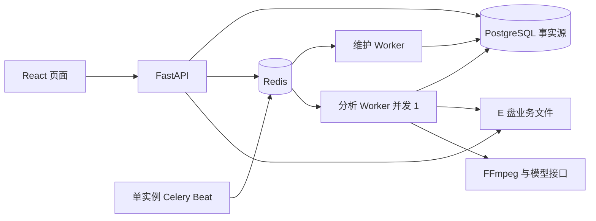

# 课迹：最终版技术方案

> 状态：架构审查与关键取舍已确认；第 1 至第 5 窗口均已实施并按各自范围验收。第 6 窗口原视频与笔记分离仍待后续实施；MVP 已通过最终验收。
> 更新日期：2026-10-04。
> 范围依据：[最终版产品设计](../product/final.md)。已有能力与历史取舍见 [MVP 技术方案](mvp.md) 和 [第六窗口验收记录](../../.scratch/mvp-stage-6/validation.md)。产品行为及验收范围以最终版产品设计为准。

## 1. 目标、边界与实施原则

在已完成的本地 MVP 上交付四项增量能力：分片续传、受控自动恢复、单独删除原视频并保留笔记，以及可复现的执行过程。先以 `video\` 中新增的约 17 分钟授权样片核验媒体、模型和资源基线，再分阶段实施。每阶段保持现有转写、总结、鉴权与整条记录删除闭环可用。

最终版沿用语音分析范围和片段级引用，不扩展画面理解、课程问答、通用转码、移动端或公开部署。引用校验仍只证明来源与定位，不证明语义准确性或知识点覆盖。模型调用可能在结果提交前中断而重复；系统保证检查点与总结的发布条件，不承诺外部请求恰好执行一次。

| 不可妥协项 | 技术含义 |
| --- | --- |
| 单任务并发 | 全部署最多一个视频分析执行者；维护任务不能领取分析任务。其他视频任务可提交并排队。 |
| 接管安全 | 旧执行者停止未确认时禁止自动接管、清理其工作目录；心跳超时或数据库锁释放本身不是停止证明。 |
| 结果完整性 | 仅完整转写和合法引用可发布唯一总结；旧 attempt、迟到消息和写回不得覆盖结果。 |
| 数据位置 | 视频、数据库、上传临时文件及处理文件留在 `E:\VideoClip\data`；授权样片在 `video\`，均不进入 Git。 |
| 容量策略 | 不设置单文件字节数或业务目录运行期硬上限；记录实际占用，写入失败须报错并安全清理。Docker 新增占用仍按 7 GiB 条件评估。 |
| 模型与费用 | 优先沿用已验证模型；不自动切换付费模型，实际可用性与计费从账户核对。 |

## 2. 现状与技术栈选择

MVP 已具备 FastAPI 原始流上传、E 盘受控存储与文件租约，PostgreSQL 中的视频、task、attempt、投递、执行、片段检查点和总结记录，Redis/Celery 单并发 Worker，FFmpeg 时间轴校验，以及 React/TypeScript 页面。真实浏览器使用 368.6 秒授权样本完成 13 段 ASR、总结、人工恢复和引用回看；约 17 分钟新样片及最终版功能尚未验收。

| 层次 | 最终版选择 | 新增或沿用的职责 |
| --- | --- | --- |
| API 与业务 | 现有 Python、FastAPI、Pydantic | 增量上传协议、媒体删除和统一的状态查询；继续由业务操作管理事务。 |
| 持久化 | 现有 PostgreSQL、SQLAlchemy、Alembic | 扩展上传、到期恢复、媒体状态和执行事件；数据库仍是事实源。 |
| 异步执行 | 现有 Redis、Celery | 分析 Worker 保持并发 1；增加单实例 Celery Beat 与只消费维护队列的轻量 Worker。 |
| 媒体与模型 | 现有 FFmpeg、ffprobe、ASR/LLM 适配器 | 保持冻结配置、片段指纹与总结校验；长样本验证后才调整新任务的配置。 |
| 浏览器 | 现有 React、TypeScript、Vite、XMLHttpRequest | `Blob.slice()` 分片、续传进度、等待/恢复时间线及无视频笔记页面。 |
| 文件摘要 | Python `hashlib`；浏览器增量 SHA-256 使用 `@noble/hashes` | 分块计算，不把整段大文件读入浏览器内存；安装时锁定经验证版本。 |
| 本地运行与验证 | 现有 Docker Compose、pytest、Vitest、Playwright | 新组件复用后端镜像；补迁移、故障与长视频真实浏览器验收。 |

Celery Beat 只发起周期协调，不决定分析任务是否可接管；维护 Worker 读取 PostgreSQL 并执行有界维护操作。维护入口调用临时上传回收 `reclaim_expired_uploads`、投递协调 `coordinate_analysis_deliveries` 和 Stage 5 恢复扫描；恢复扫描只检查共享冷却、停止证据、请求额度与执行资格，不调用 ASR/LLM、不领取分析。分析队列与维护队列分开；维护过程在长视频分析或分析 Worker 崩溃时仍可运行。Beat 在一个部署中只运行一个实例，其调度文件放在 E 盘项目数据目录。不要在 API 与分析 Worker 内再分别启动调度循环。

新增组件使用现有模块化单体的业务操作与数据模型，不另建服务数据库。具体可执行版本以依赖锁和 Compose 验证为准。浏览器增量 SHA-256 的依据见 [@noble/hashes 官方仓库](https://github.com/paulmillr/noble-hashes)；浏览器原生 `SubtleCrypto.digest()` 不支持流式输入，见 [MDN 说明](https://developer.mozilla.org/en-US/docs/Web/API/SubtleCrypto/digest)。

### 2.1 职责、接口与写入权限

沿用 [MVP 的模块职责与依赖方向](mvp.md#31-模块职责与依赖方向)。任务状态、attempt、执行权和重试共同构成任务生命周期职责；PostgreSQL 保存明确归属的持久事实。最终版新增入口必须组合调用相同的业务操作，由业务操作管理短事务和写入门禁。

| 边界 | 最低接口合同及职责 |
| --- | --- |
| HTTP / Celery / 维护入口 | 转换协议、装配依赖、发起业务操作；维护入口不能另写一套领取、恢复、取消或发布规则。 |
| 任务生命周期 | 管理 task、attempt、投递、执行停止事实和预算；统一提交检查点与总结，协调共享冷却、到期等待与媒体取消。 |
| 模型适配器 | 返回转写或待校验总结，以及稳定错误码、可取得的等待提示和筛选后的诊断元数据；供应商响应格式和密钥不作为跨模块业务参数。 |
| 存储操作 | 提供受租约保护的偏移写入、截断、同步、摘要核对、交接和可重入清理；调用者不得自行拼接受控路径或绕过写入者租约。 |
| 进程监督 | 第 3 窗口已落地：execution/task/attempt 绑定 Worker 代次、容器和 Linux session；同容器 PID 1 监督器回收 session 内的 FFmpeg、ASR/LLM 请求及其他受控后代，业务事务校验证据后写入对应执行记录。 |

接口包含错误、超时、幂等性与副作用约束；持久化适配器在业务操作内部协作，ORM 会话不作为跨模块业务入口的公共参数。通过组合装配这些依赖。状态转换、错误分类、恢复资格、退避、检查点匹配和请求指纹使用纯函数，显式传入冻结配置、时间及必要的随机输入；网络、进程、文件和事务副作用留在业务操作与适配器中。

## 3. 第一关：长视频与环境基线

在开发增量功能前，对新增授权样片读取实际字节数、SHA-256、媒体流、时长、起始时间、时间轴映射与浏览器可播放性，确认符合已支持的媒体规则。先检查 E 盘可用空间，记录原视频、音频中间文件、PostgreSQL/Redis、容器层及日志的处理前后与峰值占用。

使用冻结配置测试真实 ASR/LLM，记录片段数、耗时、限流、总结输出长度及合法引用。MVP 的 6 分钟样本不能代替本关。现有 task 级总结请求总上限为 3；若新样片在该预算内无法产生合法总结，先分析上下文与输出限制，再为**新建任务**验证配置或提示词调整。已有 attempt 继续使用其冻结快照，不拼接不同版本的检查点，也不静默使用付费模型或截断转写。

本关记录账户侧模型可用性及计费信息，区分本地零费率配置与实际账单事实。20 分钟时长边界另行验证，不能把约 17 分钟实测称作完整 20 分钟模型验收。

**第 0 窗口实测（2026-10-03）：**约 17 分 41 秒 MP4/H.264/AAC 授权样片在 Stage 2 真实浏览器流程通过，36/36 段 ASR 成功，v5 总结一次请求通过结构/引用校验；6/6 引用的原文和时间匹配，两处播放器跳转继续播放。execution 确认停止后仅重启 API/Worker，并在重启后读回结果。v4 在 3072 和 6144 输出上限下均触及 `finish_reason=length`，因此新 task 改用有长度约束的 v5 提示词及 8192 输出上限；旧 v4 冻结快照保持可解析。资源、失败尝试、配置哈希和未验证项见[第 0 窗口验收记录](../../.scratch/final-stage-0/validation.md)。这不是 20 分钟真实模型验收；账户侧账单/余额未取得证据。

## 4. 分片续传

### 4.1 协议与持久化

选择 **8 MiB** 为默认分片大小，最后一片可更小；这是传输单元，不是视频字节上限。大文件使用顺序分片，避免并行写同一源文件。继续保留现有普通上传接口供已有调用方使用；第 2 窗口后浏览器默认使用分片续传接口。

在现有 `UploadHandoff` 上增加协议类型、声明总字节、预期完整 SHA-256、已确认偏移、到期时间与完成结果；新增按 `upload_id + chunk_index` 唯一的分片记录，保存偏移、长度与 SHA-256。`Video.upload_id` 的唯一约束继续保证一次上传只生成一条视频。会话归属用户，沿用 Cookie / CSRF 校验与受控文件名，上传会话编号不授予跨账号访问权。

第 1 窗口已定稿并实现以下 HTTP 路径。创建带用户范围的 `Idempotency-Key`；分片请求使用 `application/octet-stream` 和 `X-Chunk-SHA256`。所有变更沿用 Cookie/CSRF/Origin 验证和用户归属检查：

| 操作 | 行为 |
| --- | --- |
| `POST /uploads` | 保存文件名、总字节及小写完整 SHA-256；返回会话编号、8 MiB 分片规格和 24 小时有效期。相同幂等键与元数据返回原会话。 |
| `GET /uploads/{id}` | 返回状态、服务端确认偏移、下一索引、分片摘要、到期时间及完成后的视频 ID；不续期，并在租约下核验确认内容、截去未确认尾部。 |
| `PUT /uploads/{id}/chunks/{index}` | 流式校验实际长度及摘要，严格顺序写入一个受控 `.part` 文件；文件 `fsync` 后才提交分片行与确认偏移。完全相同重放幂等，冲突/乱序返回稳定错误。 |
| `POST /uploads/{id}/complete` | 核对全部分片和完整 SHA-256、ffprobe 时长与时间轴规则，再沿用持久化交接意图、原子改名和唯一视频登记；重复完成返回同一视频。 |
| `DELETE /uploads/{id}` | 持租约放弃并清理未完成会话；已登记视频必须走原视频删除接口。可重试的到期回收入口为 `reclaim_expired_uploads(factory, store, now=None, limit=100) -> int`；第 2 窗口已把它接入独立维护周期。 |

会话从创建或最后一次成功的新分片/完全相同重放起有效 24 小时。查询、错误请求和部分传输不续期。主要稳定错误包括 `UPLOAD_BUSY`、`UPLOAD_OUT_OF_ORDER`、`UPLOAD_CHUNK_CONFLICT`、`UPLOAD_INCOMPLETE`、`UPLOAD_EXPIRED`、`UPLOAD_STORAGE_CORRUPT`、`UPLOAD_CONFIRMATION_PENDING`、`UPLOAD_FINALIZATION_PENDING` 和 `UPLOAD_CLEANUP_PENDING`；完整表、状态图及请求/响应样例见[第 1 窗口规格](../../.scratch/final-stage-1/spec.md)。

### 4.2 写入与故障边界

所有分片写入现有 E 盘 `incoming` 下的单个受控 `.part` 文件；复用上传租约，避免两个请求同时改写。先写到约定偏移并 `fsync`，再提交分片记录和已确认偏移。若在文件写入后、数据库提交前退出，下一请求将未确认尾部截回已确认偏移再重写；若数据库已提交，重复请求核对长度及摘要后复用。完成前重算整个文件 SHA-256，避免已持久化元数据与文件内容失配。

文件与数据库协调在持有同一租约时执行。文件短于已确认偏移，或已确认分片的实际内容与摘要不符时，返回稳定的存储损坏错误，禁止继续推进偏移或登记视频，保留失效和清理依据；不能通过修改已确认元数据把损坏伪装成可续传。租约保护写入、交接和清理，不作为 Worker 或在途媒体读流已停止的证明。

跨进程文件租约使用固定 inode 的标记文件。释放租约后不 unlink 标记，避免进程 A 解锁、进程 B 锁住旧 inode、进程 C 创建同路径新 inode 并同时取得锁的竞争；因此已清理的上传可能保留一个 1 字节标记文件。安全回收只删除可证明不再使用的上传内容，不删除活动租约标记。

完成请求沿用现有“持久化交接意图 → 原子改名 → 视频登记”的恢复边界；改名后 API 退出时不得再创建第二条视频。媒体失败、磁盘写满及权限错误保留稳定原因，按现有清理意图和租约安全回收。过期时间以最后有效活动延长，清理必须确认无活跃写入者；过期并不绕过文件租约。

鉴权播放与 Range 响应在正常结束、客户端断开或响应取消时关闭已打开的媒体文件句柄，避免已删除视频因未完成的播放器请求继续占用 E 盘。关闭服务端句柄不撤销已经发送到客户端的字节，也不把文件租约当作在途媒体读取的停止证明。

原始文件与处理中间文件可能同时占用空间。准入不依据固定 5 GiB 水位或单文件字节上限，但实际磁盘不足应中止当前操作、记录可见错误并清理；不能宣布上传完成或分析成功。第 0 窗口的容器可写层处理中峰值及 E 盘空闲差额归因仍未验证；第 1 窗口记录了实际 HTTP 上传前后的应用目录字节数与 E 盘可用空间，但没有进行峰值采样或归因，不替代上述未验证项。

### 4.3 浏览器摘要与恢复

第 2 窗口将默认浏览器上传切换为上述分片接口，保留 `/videos` 普通上传路由供旧调用方。`@noble/hashes` 锁定为 `1.8.0`；Web Worker 对 8 MiB 的 `Blob.slice()` 增量计算完整 SHA-256 和各片 SHA-256，不把大文件读入内存。摘要计算、上传与完成校验分别显示，XHR 请求可中止；已确认偏移与当前片发送进度分开展示。

在首次创建请求前，浏览器按用户 ID 在 `localStorage` 持久化文件名、长度、摘要、幂等键、会话 ID 和创建时间，不持久化视频内容或凭据。刷新后必须重新选文件并重算摘要；摘要一致时复用同一幂等键和服务端会话。不同内容即使同名同长度也使用新会话，不接续旧分片。每次不确定的创建、分片或完成结果都先查询服务端状态；只根据 `confirmed_offset` 推进，不以已发送字节推测确认。暂停中止本地计算/请求并保留会话；放弃调用 DELETE，只有 204 清理完成时才删除本地条目，202 保留待清理状态。登出、会话过期或当前账户组件卸载时中止旧请求并释放文件引用。

### 4.4 临时上传周期回收

第 2 窗口新增单实例 Beat，默认每 60 秒投递临时上传回收；第 4 窗口在同一个 Beat 增加分析投递协调任务。持久调度文件位于 Stage 2 的 `data/mvp-stage-2/app/maintenance-beat-schedule`。分析任务明确路由到 `analysis`，分析 Worker 只消费该队列且 `--concurrency=1`、prefetch 1；维护 Worker 只消费 `maintenance`、并发 1。上传回收与投递协调各自默认扫描 4 项并限制在 1–8；分析协调节拍默认 60 秒，均通过现有维护任务运行。维护 Worker 调用回收和统一投递业务入口，不领取分析任务、不调用 ASR/LLM。投递操作保留既有 ACK 与可信停止语义，并由分析 Worker 在实际领取处执行全局安全门禁。

Beat 发布前以 Redis 单飞键合并重复的排队/运行任务；维护任务再以各自 PostgreSQL advisory lock 跳过并发扫描。Celery late-ack 和 Worker 丢失拒绝策略让维护 Worker 重启后重新处理；上传清理失败仍由持久化 `cleanup_intent` 标识并供后续周期重试。文件清理须取得上传租约并核对完成交接、登记视频；活跃写入跳过，稳定 inode 的租约标记不删除。分析协调额外使用独立的 owner-token Redis 锁（180 秒 TTL），数据库连接释放时 advisory lock 随之释放；任务超时为 140/150 秒，锁释放核对 owner，遗留 Redis 锁可过期恢复。上传回收与分析协调各有独立锁和有界扫描，在并发 1 的维护 Worker 队列中轮转。Compose 复用后端镜像；维护 Worker 与 Beat 分别设 384 MiB/192 MiB 内存和 64 PID 上限，各自 JSON 日志轮转 10 MiB × 2。实测 Beat 空闲约 69 MiB，因此最终上限为 192 MiB；实际资源及上传回收证据见[第 2 窗口验收记录](../../.scratch/final-stage-2/validation.md)，投递协调证据见[第 4 窗口验收记录](../../.scratch/final-stage-4/validation.md)。

## 5. 排队协调、补投与后续恢复

### 5.1 Stage 4：持久化资格和唯一领取

第 4 窗口已把可排队、尚未领取的分析任务交给 PostgreSQL 协调。新视频 task 按 (queue_entered_at, task.id) 排序；提交相同时使用稳定 task UUID 决胜。HTTP / 人工恢复和 Beat 扫描不能用发布顺序改变领取公平性。分析 Worker 在实际 claim 处再核对同一排序、视频可用性、task 当前 attempt、attempt 仍 queued 且 claim_count=0，并使用原全局 execution advisory lock 与未确认 execution 查询。一个 task / attempt 的过期消息会被忽略并 ACK，不产生副作用。

HTTP 提交、人工恢复和扫描都调用 analysis_delivery.coordinate_analysis_delivery。reservation 在短事务锁定 video、task、attempt、delivery 并写入操作代次；Celery 网络发送在事务外发生；回执在另一短事务中按代次与当前资格 CAS。reservation 提交后进程退出、发送结果 unknown、成功发送但确认写回丢失、发送后未领取，都由 delivery_next_check_at 及下一代操作协调。sent 不等同于已领取。Redis 只承载 task / attempt 消息，不是业务事实源。

两个维护锁互相独立：上传回收和分析投递协调各有 Redis SET NX token lock（TTL 180 秒、释放时 owner 比对）及 PostgreSQL advisory lock。过期 Redis 锁自行释放；进程退出会释放 PostgreSQL session lock。两项 Beat 节拍默认 60 秒，维护任务扫描上界为 4 项，软/硬时限 140/150 秒；维护 Worker 并发 1，继续消费已有临时上传回收和新增分析协调任务。独立键和有界扫描避免遗留锁永久停扫，也避免一个长扫描长期饿死另一个维护操作。维护 Worker 只扫描、判定和发起投递，不 claim 分析、不调用 ASR/LLM；分析 Worker 仍并发 1、prefetch 1，ACK 策略和可信停止流程不变。

若全局未确认 execution 的绑定身份完整、监督器已登记且 process_scope 受第 3 窗口支持，状态可报告 execution_slot_occupied。身份缺失、监督器/容器异常或边界不受支持时报告 stop_confirmation_required，并保持人工处理；排队资格不构成接管许可。即使之后人工确认停止，本窗口也不自动重试任何已经开始执行的 attempt。

### 5.2 Stage 4：独立、有界的投递预算

| 环境变量 | 默认值 | 硬范围 | 语义 |
| --- | ---: | ---: | --- |
| ANALYSIS_DELIVERY_RETRY_LIMIT | 8 | 1–32 | 首次发送之后最多接受的补投 reservation 次数。 |
| ANALYSIS_DELIVERY_DEADLINE_SECONDS | 86,400 秒 | 60–604,800 | 第一次发送 reservation 后累计的活跃投递时间上限。 |
| ANALYSIS_DELIVERY_SCAN_LIMIT | 4 | 1–8 | 每轮 maintenance 扫描条数上限。 |
| ANALYSIS_DELIVERY_INTERVAL_SECONDS | 60 秒 | 60–3,600 | Beat 协调节拍。 |
| ANALYSIS_DELIVERY_OPERATION_TIMEOUT_SECONDS | 60 秒 | 30–600 | pending reservation 未有回执时允许恢复的等待期。 |
| ANALYSIS_DELIVERY_BACKOFF_BASE_SECONDS | 60 秒 | 1–3,600 | 失败/未知结果的指数退避基数。 |
| ANALYSIS_DELIVERY_BACKOFF_MAX_SECONDS | 900 秒 | 60–86,400 | 退避上限，必须不小于基数。 |

首次 reservation 计入 delivery_operation_count 但不计入 retry。此后每个被接受的唯一 reservation 在同一事务增加 delivery_retry_count；默认最多 9 个 reservation（首次 1 次 + 8 次补投）。扫描、重复请求、幂等重放、未到期检查及正常排队不扣次数。reservation 已持久化后即算已接受，即使之后进程退出或发送结果未知也不返还。

delivery_deadline_at 在首次 reservation 时设定，只累计可以推进投递的时间。execution 占位、停止确认阻断及 queue_order_wait 会记录 delivery_blocked_since 并暂停时钟；阻断解除后按其持续时间顺延。这样长视频执行或未受支持的停止场景不会耗尽 broker 补投预算。退避为 min(max, base × 2^retry_count)，默认依次为 60、120、240、480、900 秒，之后封顶；所有判定显式接收 UTC now，不使用 Redis ETA/countdown 作为长期状态。

补投次数耗尽或未阻断的活跃 deadline 到期后，task、attempt 和 delivery 进入明确 failed 终态，错误码分别为 ANALYSIS_DELIVERY_RETRIES_EXHAUSTED / ANALYSIS_DELIVERY_DEADLINE_EXPIRED，领取资格被撤销，迟到消息无法启动。补投预算不与 execution-failure recovery 或 LLM summary request 预算共享；attempt 序号不能代替补投数。恢复或创建同 task 新 attempt 不会清零已初始化的 Stage 4 次数、操作数或截止时间。

### 5.3 迁移和历史兼容

迁移 b4c91e7a2d60 只添加本窗口必需的 nullable task 协调列、排序索引和 TaskDelivery.operation_generation，不为历史行回填默认值。协调器只扫描显式初始化了队列时间与预算的任务；既有 failed / awaiting_summary 不自动重新排队，不按 attempt 序号估算预算，不修改冻结快照、来源不匹配记录、已发布结果或检查点。符合旧有人工恢复资格的历史任务可由显式操作一次性初始化新的协调预算；这不推断旧供应商请求是否到达。

### 5.4 Stage 5：共享冷却与受控自动恢复（已完成）

共享额度以 `(provider, account_reference, model)` 为键保存在 PostgreSQL。`SILICONFLOW_ACCOUNT_REFERENCE` 是 1–64 字符、非秘密的稳定账户引用；同一账户轮换 API key 时保持不变，真实切换账户时显式更换。新 task 将引用冻结到 ASR/总结配置；不含引用的历史冻结快照继续兼容部署配置引用，不回写快照。

| 环境变量 | 默认值 | 硬范围 | 语义 |
| --- | ---: | ---: | --- |
| `MODEL_COOLDOWN_BACKOFF_BASE_SECONDS` | 60 秒 | 1–3,600 | Retry-After 缺失/非法时的指数退避基数。 |
| `MODEL_COOLDOWN_BACKOFF_MAX_SECONDS` | 900 秒 | 60–86,400，且不小于基数 | 本地退避上限，不截短合法供应商等待。 |
| `MODEL_WAIT_SINGLE_LIMIT_SECONDS` | 86,400 秒 | 60–604,800 | 单次模型冷却等待上限；超过时转人工并保留完整供应商冷却。 |
| `MODEL_WAIT_TOTAL_LIMIT_SECONDS` | 259,200 秒 | 60–604,800 | task 生命周期累计等待上限；重启和新 attempt 不清零。 |

客户端子进程只通过稳定错误码、最多 128 字符的 `Retry-After` 原值及 UTC 响应观测时间回传 429；不传递密钥或响应正文。按照 RFC 9110 §10.2.3 解析非负秒数或 HTTP-date。没有合法字段时使用 `[ceil(nominal/2), nominal]` 的 equal-jitter 指数退避，`nominal=min(max, base×2^(n-1))`；随机值与 UTC 时间由纯函数显式注入。429 更新用数据库行锁原子累积次数并写 `max(当前截止, 新截止)`，较短建议不缩短共享截止。成功请求仅在请求开始时间已过截止后清零连续限流数。

ASR 每段、summary 及同 attempt 的有限修复请求在启动/预留前都再次检查共享冷却，并先提交预留事务，再发起网络请求。调用前被门禁阻断是正常等待，不记作执行失败，不预留 ASR/总结请求或自动恢复次数；已经启动的 429 是真实失败，预算不返还。等待状态、额度身份、起点、供应商截止、单次期限、累计已等待和下一阶段持久化；due 扫描复核当前共享冷却，冷却延长时只更新等待，不创建重复 attempt。`waiting_model` 不进入可执行队列；到期后经统一生命周期事务重新入队。冷却期间暂停第 4 窗口投递 deadline，解除后顺延；8 次补投与 24 小时可推进期限保持原义。

自动恢复只接受稳定白名单：可信 Supervisor 确认后的 `WORKER_EXECUTION_INTERRUPTED`、ASR/LLM 网络和超时、上游 5xx/过载及 429。鉴权/权限、无效模型、源文件、非法媒体、冻结来源或指纹不匹配、总结结果校验失败、未知错误和停止无法证明均不自动重跑。旧 execution 必须有第 3 窗口可信证据，当前 task/video 绑定及其他门禁有效后才能创建 child。自动操作接受并创建 child 时同事务增加恢复数，每 task 最多 2 次；等待续接、扫描、人工恢复和补投不增加它。完整转写使用 `summary-only`，未完成转写只复制 manifest 与音频/请求指纹均匹配的已成功片段。供应商响应已经返回但检查点尚未提交时可能再次请求，不承诺外部请求恰好一次。

| 预算 | Stage 5 完成规则 |
| --- | --- |
| 投递补投 | 默认 8 次、活跃期限 24 小时；执行占位、停止阻断和公平排队暂停期限。与其他预算独立。 |
| 执行失败自动恢复 | 每 task 最多 2 次；仅自动接受并创建子 attempt 时原子计数。 |
| 总结请求 | 每 task 最多 3 次，跨自动/人工 attempt 共用；每次请求开始前预留，失败或预留后中断不返还。预算耗尽保留合法转写并关闭无效恢复入口。 |

迁移 `7c2a91e5b04d` 只增加 Stage 5 所需字段和冷却表；历史 `failed` / `awaiting_summary` 不自动纳入或伪造预算、账户身份、冻结快照。新任务显式初始化预算；部署后的显式人工恢复/总结操作在被接受时才登记历史 task 的 Stage 5 纳入与独立预算。完整参数、状态表、故障分类和验收证据见[第 5 窗口规格](../../.scratch/final-stage-5/spec.md)及[验收记录](../../.scratch/final-stage-5/validation.md)。

第 6 窗口处理视频媒体与笔记分离删除；第 4 窗口只保留已有整条删除取消门禁。删除和投递 reservation 共用 video/task 锁，删除获胜后撤销队列资格；发送中的迟到结果无法恢复 task，迟到消息也无法通过 Worker claim。

第 3 窗口的真实停止确认边界保持不变：只覆盖已绑定的 Stage 2 Linux execution session。监督器/容器/宿主机强停、缺少 execution 身份或不可验证的证据仍阻断自动接管及危险清理，需要人工核对；详见[第 3 窗口规格](../../.scratch/final-stage-3/spec.md)和[验收记录](../../.scratch/final-stage-3/validation.md)。

## 6. 单独删除原视频并保留笔记

为视频增加独立的媒体状态，例如“可用／删除待处理／已删除／清理失败”；现有记录整体删除状态保持独立。在视频行锁保护的同一短事务内持久化媒体删除意图、取消所有未完成分析并使其投递、等待及恢复计划失效，以该事务提交为生效点。媒体入口及领取、恢复、检查点写回和总结发布均核对独立媒体状态；之后的新媒体请求和迟到结果被拒绝。任务取消不等于执行已停止，未确认 execution 继续占据全局执行位；待相关执行者停止确认且文件租约可获取后删除原视频。

视频记录及生效点前合法提交的分段转写、章节、知识要点和来源信息继续保留，已发布总结不因单独媒体删除失效。笔记读取核对用户归属与记录整体状态，不以原文件存在或媒体可用为前提；媒体删除待处理、清理失败和已删除时笔记均可读。未完成任务进入取消终态，覆盖排队、运行、限流等待和等待总结；即使转写完整也不在删除后补生成总结，不能把不完整总结改成成功。

文件删除失败保留路径、删除意图和稳定原因，进入清理失败状态；媒体和分析仍被阻断，重试只重新执行安全清理。本版不提供撤销删除，不因原文件暂时仍存在而恢复媒体或任务资格。页面区分删除处理中、清理失败和已删除，不能在物理清理完成前报告删除成功。

播放器及所有引用回看入口在前端关闭。媒体接口在打开文件前按视频行锁核对删除意图，以串行化新请求和删除；生效前已经打开的响应可能继续读取，已下发内容也无法追回，本版不承诺强制撤销在途响应。文件租约不保护这类读流，不能用取得租约推断它们已结束。

整条记录删除继续回收视频剩余文件、笔记、任务和总结。它必须兼容“原视频已删除”的状态并可重复调用；与正在进行的媒体清理、自动恢复和上传交接通过相同的视频行锁及文件租约协调。数据库迁移为现有视频补“媒体可用”默认状态，不改动已有总结内容或 task 身份。

## 7. 执行过程、隐私与本地运行

页面继续使用状态轮询，展示上传、排队/投递、转写片段进度、总结、限流等待及预计恢复时间、停止确认、清理与失败原因。等待中的任务可以展示下一次检查时间；遇到无法自动证明安全的状态时给出人工处理步骤。只对已确认分片和已提交片段显示完成进度，不将模型等待虚构为确定百分比。

执行位被其他未确认 execution 阻断时，排队任务显示该等待原因；恢复或请求额度耗尽、媒体删除取消时不展示无法执行的恢复操作。媒体清理失败后提供清理重试，笔记阅读继续可用。

现有状态表保持唯一事实源。为演示和刷新后追溯，增加轻量执行事件记录：时间、视频/task/attempt 编号、阶段、稳定错误码、自动/人工动作和关联请求编号。日志使用结构化字段关联同一事件；不写入密码、Cookie、密钥、课程原文、完整转写或原始模型响应。页面只返回当前用户的数据与经过筛选的诊断信息。

Compose 增加 Beat 与维护 Worker，两者复用现有后端镜像；Beat 的本地调度文件和业务临时文件落在 `E:\VideoClip\data` 的项目目录。继续隔离 Stage 1 测试库与 Stage 2 演示数据，服务仅开放本机需要的端口。记录新增镜像/缓存、容器层与日志占用；预计及实测不超过 7 GiB 才沿用现有 Docker 环境。全局 Docker 调整必须先做已有项目基线、备份、回滚和运行验证。

## 8. 数据迁移与兼容处理

Alembic 分阶段迁移：先加入可空或带默认值的新字段及新表，回填现有视频“媒体可用”状态，再加约束。保留旧 `/videos` 普通上传与整条删除接口，使 MVP 页面和脚本在分片功能上线时仍能运行；新页面再切换默认上传方式。已有上传交接、任务、片段及唯一总结不得因迁移重建或更改编号。

任务状态约束需容纳等待与恢复阶段，且区分“分析结果终态”“执行停止确认”“清理状态”；迁移前核对现有历史 `failed` / `awaiting_summary` 数据及两条已知来源失配任务，不擅自自动恢复或清理它们。保留当前 `task_acks_late=False` 等投递行为，先用数据库协调补齐恢复；调整 Celery 消息确认策略必须另做重复投递和执行门禁测试。

迁移按窗口拆分：第 4 窗口 `b4c91e7a2d60` 仅增加 nullable 排队协调字段、排序索引和投递操作代次；后续窗口才增加各自所需的媒体、共享冷却或执行恢复字段。MVP 历史 attempt 均不能仅按序号回填成自动恢复次数；新计数字段的默认值也不代表历史失败任务已获自动恢复授权，已有任务的纳入范围在迁移前明确核对。

## 9. 分阶段实施与验证

| 阶段 | 交付和直接验证 |
| --- | --- |
| 0. 长样本基线 | **约 17 分 41 秒样片主流程通过。** 36 段 ASR、v5 总结、两处引用回看和 API/Worker 重启读回通过；Docker 新增占用低于 7 GiB。容器可写层处理中峰值未单独采样，E 盘空闲差额未归因；20 分钟模型和账户账单未验证。详见[验收记录](../../.scratch/final-stage-0/validation.md)。 |
| 1. 分片续传 | **第 1 窗口后端完成**：迁移、HTTP 会话与分片接口、启动恢复、租约回收和 Stage 2 后端验收。**第 2 窗口完成**：浏览器摘要/重选/续传、独立临时上传周期回收、Stage 2 真浏览器和 Beat→Redis→维护 Worker 验收。详见[第 1 窗口规格](../../.scratch/final-stage-1/spec.md)、[第 1 窗口验收](../../.scratch/final-stage-1/validation.md)和[第 2 窗口验收](../../.scratch/final-stage-2/validation.md)。 |
| 2. 可信停止与排队活性 | **第 3 窗口可信停止确认、第 4 窗口排队协调/投递补偿及第 5 窗口共享冷却/受控自动恢复均已完成**：Stage 3 绑定 Linux session 的停止门禁；Stage 4 持久化队列资格、8 次补投及 24 小时可推进期限；Stage 5 账户/模型共享冷却、到期续接、最多两次自动恢复和三次总结请求独立额度，均以本地隔离服务和浏览器验收。详见[第 5 窗口验收记录](../../.scratch/final-stage-5/validation.md)。 |
| 3. 视频/笔记分离 | 单独媒体删除、原子取消未完成分析、保留笔记及关闭新媒体访问；迟到写回、清理失败后持续阻断及整条删除回归通过。 |
| 4. 最终验收 | 真实浏览器用新样片完成全链路和故障演示，补复现文档、运行记录与资源证据。 |

每个阶段先跑直接相关测试，再跑受影响范围的完整后端 pytest、Stage 0 回归、Ruff、mypy、前端 lint/单测/构建及必要的 Playwright 测试。跨模块里程碑还检查 Alembic、Compose 配置、依赖完整性及重启后持久化。新增行为需要回归测试；不得用直接改写 Stage 2 业务表伪造真实验收场景。

重点故障用隔离环境可控注入并留下状态证据：

- 上传中途断开、重复分片、不同内容同索引、完成请求丢失响应、改名后 API 退出、过期时写入者仍活跃、磁盘写入失败，以及文件短于已确认偏移或已确认内容损坏。
- 数据库提交后投递前退出、投递成功但确认丢失、忙时消息被 ACK 后解除阻断仍可执行、重复/迟到消息、两个协调任务同时扫描，以及补投独立耗尽但不误扣自动恢复次数。
- Worker 强杀后子进程残留、数据库锁断开但子进程仍在、停止确认缺失、旧执行确认迟到、确认时数据库不可用；均不得错误释放执行位或清理文件。
- 同账户同模型共享冷却、其他模型阶段仍可执行、重启后冷却期限保留、429 与调用前正常等待的不同计数、到期续接不扣恢复额度，以及自动恢复用完三次总结请求后人工入口受限。
- 模型响应后检查点未提交、请求开始记录后进程中断、自动与人工恢复竞争及幂等重放，验证恢复次数和总结请求预留不重复或重置。
- 单独删除媒体与排队、运行、限流等待、等待总结或恢复竞争；取消生效后拒绝迟到检查点与总结，已有合法笔记仍可读。
- 文件删除失败后媒体继续阻断且仅可重试清理、删除与新媒体打开竞争、既有读流的承诺边界、无视频笔记读回、整条记录再次删除。

最终产品验收按[最终版产品设计](../product/final.md)逐项核对：约 17 分钟授权样片在真实浏览器完成上传/续传、真实 ASR/LLM 与两处引用回看；一次 Worker 中断和一次模型限流或等效故障后安全恢复；无法证明停止时拒绝接管；原视频删除后笔记可读、生效后的新媒体请求被拒绝；整条记录删除后相关数据不可访问。最终验收还要求上述隔离故障回归全部通过。另验 20 分钟时长边界、单分析并发、E 盘持久化及 Docker 新增占用。演示证据只声明实测过的条件。

## 10. 当前进度与下一步

| 项目 | 当前事实 |
| --- | --- |
| MVP | 第六窗口验收通过；真实浏览器验证约 6 分钟样片，13 段转写、总结和人工恢复。 |
| 最终版设计 | 产品目标、主技术栈及架构审查取舍已确认；第 1 至第 5 窗口均已验收。第 6 窗口原视频与笔记分离及最终展示材料仍待后续窗口。 |
| 新样片与第 0 窗口 | 约 17 分 41 秒样片媒体适配、真实 ASR/LLM、引用回看和 API/Worker 重启读回已通过；v4 输出截断与 v5 修正及资源事实见[验收记录](../../.scratch/final-stage-0/validation.md)。不代表 20 分钟或最终版增量功能通过；账户计费、容器可写层运行峰值及 E 盘差额归因未验证。 |
| 增量功能 | 第 1 窗口分片上传、第 2 窗口浏览器续传/临时上传周期回收、第 3 窗口可信停止确认、第 4 窗口排队协调/投递补偿和第 5 窗口共享冷却/受控自动恢复均已验收。第 6 窗口单独媒体删除、笔记保留和最终时间线仍待实现或验收。 |

第 5 窗口“共享限流与受控自动恢复”已完成；本次交付不自动开始第 6 窗口“原视频与笔记分离”。第 4、5 窗口隔离真实链路仅使用隔离 Compose 网络可达的本地 ASR/LLM 替身，不调用供应商，不代表实测供应商限额或账单。规格和验证证据见[第 4 窗口记录](../../.scratch/final-stage-4/spec.md)、[第 5 窗口规格](../../.scratch/final-stage-5/spec.md)及[第 5 窗口验收](../../.scratch/final-stage-5/validation.md)；第 2 窗口范围与证据见[规格](../../.scratch/final-stage-2/spec.md)和[验收记录](../../.scratch/final-stage-2/validation.md)，第 3 窗口见[规格](../../.scratch/final-stage-3/spec.md)和[验收记录](../../.scratch/final-stage-3/validation.md)。阶段 0 的 17 分钟基线已完成；20 分钟真实模型处理、账户计费证据、容器可写层处理中峰值及 E 盘空闲差额归因仍未验证。后续实现不得修改已有 v4 task 的冻结快照或检查点匹配规则。
