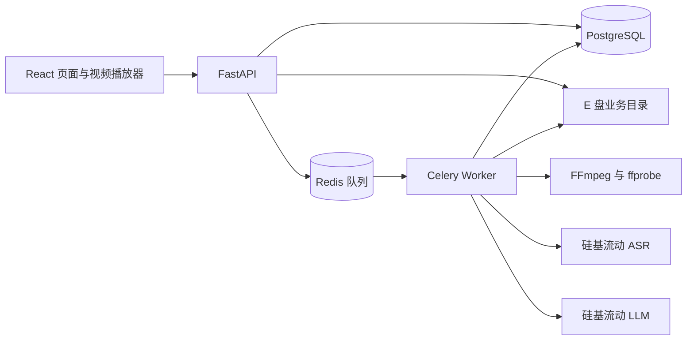

# 课程视频转写与可追溯总结平台：MVP 技术方案

> 状态：技术栈与架构契约已确认；本文作为首版实施依据。MVP 暂不实施上传视频字节上限及业务数据目录运行期总量限制，模型、环境门槛及业务行为仍需实测。
> 更新日期：2026-09-29。
> 产品依据：[MVP 产品设计](../product/mvp.md)。产品范围与验收标准以该文档为准。

## 1. 目标、范围与约束

本项目面向中文技术课程学习，完成视频上传、语音转写、结构化总结和引用回看闭环，同时展示 Python 后端与 AI 应用工程能力。首版按可持续迭代的小型项目建设，计划投入 6 周、每周 12–15 小时。

MVP 实现账号隔离、普通流式上传、单任务分析、转写检查点、总结引用校验、手动重试和整条记录删除。分析对象为语音讲解。

画面理解、屏幕代码识别、知识问答、句级时间戳、断点续传、自动故障恢复和线上部署不在本版范围内。总结完整性和语义准确性不作为工程验收门槛。

| 约束 | 实施要求 |
| --- | --- |
| 单视频 | 有效时长大于 0 且不超过 20 分钟；本版不限制上传视频的字节数，服务端验证媒体有效性和音轨。 |
| 分析并发 | Worker 服务仅一个实例、执行并发为 1；数据库执行权同时约束整个部署最多一个未确认停止的执行者，其他任务排队。 |
| 业务数据总量 | 本版暂不设业务数据目录运行期硬上限、容量准入水位或容量预留；不因目录剩余容量拒绝上传、分析或重试。 |
| 数据位置 | 持久化数据和临时业务文件位于 `E:\VideoClip\data` 下的独立目录。 |
| 模型与费用 | 优先使用硅基流动免费 ASR 和免费 LLM；付费模型切换需另行确认。 |
| Docker | 新增占用预计及实测均不超过 7 GiB 时沿用现有环境，保护已有 Docker 项目。 |
| 时间定位 | 约 30 秒的片段级区间；切片记录使用原视频播放器时间轴，媒体适配器负责映射。 |

不可妥协项：用户资源隔离、已持久化成功片段可复用、缺失片段时不交付成功的全课总结、非法引用不标记成功、受控文件路径与可重入清理、旧执行者停止未确认时禁止接管及文件清理、删除不遗留可访问的用户数据。E 盘持久化机制须通过环境验证；本版不承诺业务数据目录总量上限。

## 2. 技术栈与主要决策

| 部分 | 选择 | 用途与取舍 |
| --- | --- | --- |
| 后端 | Python、FastAPI、Uvicorn | 提供鉴权、上传、任务和结果接口；耗时分析交给独立 Worker。 |
| 数据校验 | Pydantic | 定义接口与总结结构；原文匹配和时间有效性由业务代码验证。 |
| 数据库 | PostgreSQL、SQLAlchemy、Alembic | 持久化任务与检查点，提供事务、唯一约束和数据库迁移。 |
| 任务队列 | Celery、Redis | Redis 负责投递，Celery 执行分析；业务状态以 PostgreSQL 为准。 |
| 媒体工具 | FFmpeg、ffprobe | 检查媒体、提取音频、切片并记录时间范围。 |
| 模型请求 | HTTPX、硅基流动 API | 分别封装 ASR 与 LLM 请求，统一超时、错误分类和调用记录。 |
| 前端 | React、TypeScript、Vite | 实现三个页面、上传进度、状态轮询和视频回看。 |
| 本地运行 | Docker Compose、Linux 容器 | API 与 Worker 共享业务代码和镜像，分别启动。 |
| 验证工具 | pytest、Ruff、TypeScript 检查、Playwright | 验证后端行为、代码质量及关键页面交互。 |

保留 PostgreSQL 和 Celery，主要考虑任务恢复与后端工程展示；接受相应的环境配置成本。AI 流程用普通 Python 代码组织，保持模型调用、校验和错误处理直观可查。

初始化时锁定一组已验证兼容的依赖与镜像版本，提交依赖锁文件。FastAPI 与其 Starlette 依赖一起验证，尤其检查上传和视频 Range 请求；本文不把当前最新版直接作为可用版本承诺。

Celery 官方不支持原生 Windows，因此 Worker 运行在 Linux 容器中，见 [Celery 官方说明](https://docs.celeryq.dev/en/stable/getting-started/introduction.html)。

## 3. 总体结构



- API 处理请求、鉴权和任务提交，不在请求生命周期内执行整段转写或总结。
- Worker 从队列接收尝试对应的任务编号，调用任务生命周期模块领取执行权，从数据库读取冻结配置并提交阶段、检查点和结果。
- PostgreSQL 保存完整业务状态；Redis 消息只传递任务编号，不存放视频或转写全文。
- 开发时由 Vite 代理 `/api`；本地演示时由 API 提供前端构建产物，保持同源访问。
- 视频通过鉴权后的文件接口读取，不将业务目录直接作为公开静态目录。

### 3.1 模块职责与依赖方向

后端采用模块化单体，API 和 Worker 是两个运行入口，共用数据库、业务代码和镜像。按下表划分职责，共享数据模型不表示调用者可以直接修改其他模块管理的字段。

| 模块 | 负责的行为与写入权限 |
| --- | --- |
| 账号 | 会话、密码和所属用户校验。 |
| 视频 | 媒体元数据、当前任务关联、删除状态；协调任务失效与存储回收。 |
| 任务生命周期 | 提交、attempt、状态转换、执行权、停止确认和重试资格；统一协调检查点及总结发布的事务。 |
| 转写 | 片段清单、文本及检查点复用规则，产生待提交结果；由任务生命周期操作校验执行权并提交。 |
| 总结 | 总结结构、引用及时间校验、有限修复，产生待发布结果；由任务生命周期操作统一发布。 |
| 存储 | 受控路径、流式文件写入、上传交接和可重入清理；记录文件元数据并在实际删除后完成清理。 |

依赖方向为“HTTP / Celery 入口 → 业务操作 → 领域规则及所需接口”，数据库、模型、媒体和文件适配器实现这些接口，由运行入口装配。任务编排调用转写和总结规则，两者返回不可变结果，不反向调用任务编排。入口负责协议转换和鉴权，不分别实现两套状态转换。事务由业务操作统一管理，内部持久化适配器协作完成原子写入，不把 ORM 会话暴露给调用者，也不让外部请求或 FFmpeg 占用长事务。

在实际需要替换或测试的接缝提供小接口：ASR 返回转写结果，LLM 返回待校验输出，媒体返回片段清单及时间映射，存储负责受控文件操作，投递器返回发送结果或不确定错误。接口包含超时、错误、幂等性和副作用约束；供应商响应、Celery 上下文和 ORM 会话不作为跨模块业务参数。普通内部函数无需机械增加抽象层，ASR 与 LLM 不强行合并为一个通用模型接口。

### 3.2 组合与可测试规则

任务状态、attempt 和重试共同构成任务生命周期这一项职责。通过组合注入依赖，不用业务继承链组织流程；框架需要的继承限制在适配器内。PostgreSQL 是明确的事实源，进程内缓存、Celery 结果状态及模块级可变变量均不能决定业务状态。

状态转换、错误分类、重试资格、引用规范化与匹配、时间映射计算和请求指纹写成纯函数；时间、配置及必要的随机输入显式传入。事务、网络、进程和文件副作用留在业务操作及适配器中。单元测试直接调用规则和业务接口，集成测试另行验证 PostgreSQL 与 Celery 行为；将来加入自动重试时再实现退避策略。

## 4. 核心数据

| 数据 | 主要内容 |
| --- | --- |
| 用户与会话 | 用户名、密码哈希、会话令牌哈希、过期时间。 |
| 上传交接 | 所属用户、API 实例身份、临时及正式目标路径、接收字节与源文件摘要、交接状态；关联清理记录。 |
| 视频 | 所属用户、原始文件名、不可变源文件身份、受控存储路径、大小、时长、媒体信息、当前任务及删除状态。 |
| 分析任务 | 任务编号、视频编号、尝试编号、原尝试编号、状态、阶段、成功片段数、错误码、起止时间、冻结处理配置及执行标识。 |
| 执行记录 | 所属任务、Worker 实例身份、执行标识、执行状态、开始及停止确认时间；记录本地进程组归属，停止未确认时保持占位。 |
| 投递记录 | 所属任务、投递状态、更新时间和错误；与任务创建同事务保存，独立于分析状态。 |
| 片段清单与转写 | 视频编号、切片版本、转写指纹、预期片段编号及音频 / 视频起止时间、映射版本、文本、状态、实际 ASR 模型与错误信息。 |
| 总结 | 所属视频与任务、结构版本、章节和知识要点、引用、校验结果、LLM 与提示词版本。 |
| 清理记录 | 所属上传、视频或任务、待回收受控路径、清理状态及错误；保留到文件回收完成。 |

一条分析任务记录对应一次 attempt，任务编号全局唯一，尝试编号在视频内递增。手动恢复创建新任务记录并关联原尝试，不复用旧任务编号；队列只发送该任务编号。分析状态、投递状态、执行停止事实和清理状态分别保存，不能从其中一项推断其他项已完成。

执行记录在首次领取时创建，状态为 `active`、`stopping`、`stopped`；未领取的任务没有执行记录。`stopped` 必须有对应实例的停止确认，不能由分析终态或心跳推导。

片段按“视频＋切片版本＋转写指纹＋片段编号”唯一保存。片段清单先完整持久化，成功片段数由该清单下的检查点推导；成功检查点提交数据库后才能进入下一片段。临时音频是否存在不影响转写文本持久化，完整性不能仅凭一个成功计数判断。

一个视频最多存在一个 `queued` 或 `running` 的任务，以条件唯一约束及视频行锁避免重复提交。整个部署最多存在一条停止未确认的执行记录，以独立数据库约束保持占位，即使任务已进入终态也不能据此释放执行权。阶段、检查点、总结和分析终态写入在同一短事务内校验当前任务、执行标识、运行资格及视频未删除条件；过期写入整体回滚。

### 4.1 冻结配置与复用指纹

创建任务时保存不可变配置快照：源文件身份、所选音轨、切片规格及算法版本、音频规格、ASR 供应商 / 模型 / 请求参数、LLM 供应商 / 模型 / 请求参数、提示词模板版本及内容摘要、总结结构和引用规范化版本、超时及响应限制。模板内容或其不可变版本必须可取回；密钥通过配置引用读取，不保存到快照。

源文件身份由视频编号和上传时计算的内容摘要确定，原视频登记后不原地替换。切片版本覆盖音轨选择、时间映射及切片算法；转写指纹由源身份、切片规格、音频规格及 ASR 参数确定。采用带版本的规范化序列化和摘要算法，不把 LLM 参数或 attempt 编号混入转写指纹。

单次 ASR 请求指纹在转写指纹基础上加入片段编号及音频摘要；LLM 请求指纹由转写内容摘要、模型参数、提示词 / 修复反馈和输出结构版本确定。相同有效输入产生相同指纹，执行标识和供应商追踪编号另外记录，指纹不作为自动重发或外部幂等性的依据。

重试读取旧快照，不读取最新默认配置替换原参数。输入或转写指纹不一致时禁止复用检查点；当前程序不支持旧快照版本或原模型不可用时返回明确错误。不同配置下的结果隔离，MVP 不建设通用的历史版本兼容框架。指纹只决定本地结果复用，不提供供应商调用恰好一次保证；模型返回后、检查点提交前中断的片段允许再次请求。

## 5. 上传与分析流程

### 5.1 普通流式上传

1. 校验登录状态，在接收文件内容前同事务登记上传记录和受控临时路径；本版不按文件字节数或数据目录容量拒绝请求。
2. 浏览器以 XMLHttpRequest 发送原始文件请求体，展示已发送字节进度；后端使用请求流逐块写入受控的 `.part` 文件。
3. 服务端累计实际字节数并保存为视频元数据，不信任声明大小、扩展名或 MIME 类型；上传断开或文件系统写入失败时中止并记录可清理的临时路径。本版不设单文件字节上限。
4. 上传结束后用 ffprobe 检查有效视频流、音轨、正数且有限的时长及 20 分钟上限，并确认满足时间轴映射规则。探测设置总超时，通过参数列表调用进程。
5. 先持久化正式目标路径及交接意图，再将临时文件改名并登记视频；文件与数据库操作失败时按持久化记录补偿清理。进程在改名与登记之间崩溃时，仍能定位两端路径并判定归属。页面提示“上传完成”后仍需等待媒体校验结果。

原始请求流避免默认 multipart 临时落盘路径脱离受控文件路径，接口实现参考 [Starlette 请求流说明](https://www.starlette.dev/requests/)。服务端生成文件路径，原文件名仅作为展示元数据。

首个样本阶段确认浏览器可回看且可可靠映射时间轴的封装与编码白名单，并在上传界面说明。ffprobe 能解析不等于浏览器能播放；本版不引入整段视频自动转码。时间映射规则见 §5.7。

### 5.2 任务提交与执行

提交时锁定视频行，确认资源未删除、没有当前活动任务及未确认停止的旧执行者，并在同一事务创建冻结配置、`queued` 任务与 `pending` 投递记录。数据库提交后再投递，返回任务编号及当前投递情况，HTTP 使用 `202 Accepted`。重复提交返回既有活动任务，不能另建并行尝试。

任务状态采用 `queued`、`running`、`succeeded`、`failed`、`interrupted`、`cancelled`；运行阶段为音频提取、转写、总结和校验。清理状态另行记录为 `pending`、`running`、`done`、`failed`，不作为分析阶段或重新调用模型的理由。

| 状态转换 | 允许条件 |
| --- | --- |
| `queued → running` | 当前有效任务首次领取执行权，视频未删除。 |
| `queued → failed` | 确定未发送且未被领取的投递失败，按条件更新；不确定结果保持 `queued` 并记录投递异常。 |
| `running → succeeded` | 片段清单全部成功、总结校验通过，结果与终态同事务提交。 |
| `running → failed` | 当前执行者报告处理错误或总期限到期；执行停止事实另行确认。 |
| `queued / running → interrupted` | 用户手动恢复或启动检查已确认该尝试未开始或旧执行者完全停止，随后使原尝试失效。 |
| `queued / running → cancelled` | 删除请求使原尝试失效并请求停止；`cancelled` 不代表停止或清理已经完成。 |

终态不退回 `running`，恢复创建新 attempt。任务成功只表示结果已经校验和持久化；是否允许新的执行或文件清理，还要检查执行记录。

处理步骤：

1. Worker 通过任务生命周期模块领取执行权，登记执行标识与本地执行归属；唯一 Worker 的并发设为 1，预取设为 1。
2. FFmpeg 按冻结配置提取单声道、16 kHz、16-bit PCM 音频，按约 30 秒切分，保存完整片段清单、音频起止时间及原视频时间映射。
3. 顺序调用 ASR，每片完成即持久化文本和状态；最后一片按实际长度处理，不补足为 30 秒。
4. 全部片段转写成功后，按时间顺序将带编号的转写交给 LLM。
5. 执行结构、引用和时间校验，必要时进行有限修复。
6. 校验通过后同事务保存总结、标记成功并登记清理意图。确认本地请求、文件生产和子进程已停止，记录停止事实并释放执行占位，再按清理记录回收文件。清理失败单独记录，不把合法总结改为分析失败。

Worker 收到终态、非当前任务、已领取过的同一 attempt 或已删除资源消息时，不产生模型及文件副作用。同一 attempt 只允许领取一次；崩溃后保留中断事实，由用户新建恢复尝试，不因消息重投重新执行。

### 5.3 手动重试

- 未开始的遗留排队任务，以及失败、中断且已确认停止的任务可手动恢复；已确认停止的 `running` 尝试先按中断处理。恢复事务与 Worker 领取使用同一视频行锁：若原尝试尚未开始，先使其原子失效；若已开始，必须取得 §5.5 的停止确认。任务失败、取得数据库锁或心跳超时均不能单独作为退出证明。
- 同事务使旧尝试失效、创建新任务及投递记录，沿用原冻结配置。同一原尝试的重复恢复请求返回既有子尝试，以原尝试编号唯一约束避免重复创建。
- 复用已成功的转写，只重建并转写失败或未完成片段；总结阶段失败时直接复用完整转写。
- 临时目录按尝试隔离，旧尝试不能覆盖新尝试的文件或结果。
- 限流、网络超时、模型不可用或 Worker 中断均展示明确原因；本版由用户手动重试，不持续自动调用模型。

### 5.4 投递事实与消息确认

投递记录使用 `pending`、`sent`、`unknown`、`failed`：创建后尚未尝试发送为 `pending`，发送端获得成功返回为 `sent`，可以确认未发送为 `failed`，连接中断等无法判断是否送达为 `unknown`。`sent` 不保证 Redis 崩溃后消息仍存在，也不等于 Worker 已经开始执行。

| 故障窗口 | 处理规则 |
| --- | --- |
| 数据库提交后、发送前 API 退出 | 保留 `pending`；查询显示未投递及手动恢复入口。 |
| 发送成功但确认丢失 | 记录 `unknown`；只更新投递事实，不覆盖 Worker 已写入的分析状态。 |
| 发送明确失败 | 按“当前任务且未领取”条件标记失败；若已领取，保留执行事实。 |
| `sent` 但一直未开始，或 Redis 丢失消息 | 查询显示排队时间及待恢复提示；用户恢复原子失效旧任务，再创建新尝试，旧消息迟到时直接跳过。 |

排队提示阈值仅用于展示，不据此自动重投或判断执行者已退出。投递 `unknown` 时，手动恢复与首次领取的事务互斥，谁先取得视频行锁就决定旧任务能否开始；不能在发送异常处理器里无条件写 `failed`。

MVP 明确采用执行前确认消息：`task_acks_late=False`、`task_reject_on_worker_lost=False`、`task_publish_retry=False`，业务任务不设置 `autoretry_for`，不调用 Celery `retry()`。不配置业务结果后端，分析状态统一读取 PostgreSQL。领取前丢失的消息可能重投，领取后的崩溃需要手动恢复；确认行为及重复消息必须按锁定版本实测，见 [Celery 配置说明](https://docs.celeryq.dev/en/stable/userguide/configuration.html)。本版只有持久化投递意图和显式恢复，不引入自动 Outbox 投递器。

### 5.5 执行权、丢锁与停止确认

执行互斥采用部署内固定键的 PostgreSQL 会话级 advisory lock，覆盖分析执行期至本地请求、文件生产和子进程停止确认，使用专用连接持有，不与检查点短事务共用或随提交释放。键不随视频或 attempt 改变，以约束整个部署单分析执行；数据库中停止未确认的执行记录同时阻止再次领取。持锁连接不能带锁返回连接池，规则见 [PostgreSQL 锁说明](https://www.postgresql.org/docs/current/explicit-locking.html)。

领取时在短事务生成执行标识并登记 Worker 实例身份、进程启动身份和执行状态。每次阶段开始及副作用前检查执行资格；数据库连接或执行锁丢失后停止新调用和文件生产，取消本地请求，终止并回收所属媒体进程组。锁释放仅表示数据库会话结束，不推断操作系统进程或供应商请求已结束。

正常停止由原执行者确认本地请求、写入者及子进程已结束，再按原执行标识记录 `stopped`。删除使任务失效后，旧执行者仍可提交对应执行记录的停止回执，但不能再提交分析结果或恢复发布资格。文件清理和新执行都要求对应旧执行已停止；模型供应商已经收到的请求无法保证撤回，其迟到结果不得发布。

丢锁、Worker 崩溃或强制超时后，未取得停止回执就保持占位，提示“需停止本项目 Worker 后恢复”。MVP 提供本地维护步骤 / 命令：停止并核验本项目 Worker 容器及所属进程已退出，将退出证据与旧实例身份对应，登记停止确认，再启动 Worker 并允许用户恢复或清理；不把其他项目纳入操作，也不从 API 挂载 Docker socket。新实例不会仅凭取得锁、PID 不存在或启动时间较新自动接管旧执行。

### 5.6 有界执行与取消

上传读取、ffprobe / FFmpeg、模型请求、数据库锁等待和清理操作均设置有限总期限；网络同时设置连接、读取、写入和连接池超时。HTTPX 读取超时针对下一数据块，整个请求另受总期限约束，见 [HTTPX 超时说明](https://www.python-httpx.org/advanced/timeouts/)。限制响应体字节数、LLM 输出 token 和诊断大小，拒绝超限输出，不通过截断结果绕过结构校验。

第 1 阶段实测后锁定各阶段期限、停止宽限期与响应上限。领取时根据剩余片段数、媒体预算和最多 3 次总结请求计算有限的任务执行总期限，排队时间不计入该期限；等待心跳或下一数据块不能无限延长总期限。

媒体进程在独立进程组运行。取消或超时先停止新增工作，关闭本地 HTTP 请求，在宽限期内终止所属进程组，必要时强制终止并等待退出；未确认退出则禁止清理或新执行。Celery 强制时限只能作为最后保护，触发后按执行者未知处理，不能把子进程自动替换当作安全恢复。Worker 必须在片段、模型调用及阶段交接处响应删除 / 失效条件；测试用缩短的期限证明挂起场景能退出。

### 5.7 原视频时间轴

持久化及返回页面的 `start`、`end` 始终是原视频播放器 `currentTime` 坐标；提取音频的零点不能直接当作视频零点。媒体适配器确认音轨、容器 / 音轨起始时间和转换规则，保存映射版本及音频 / 视频两套片段区间，必要时按明确偏移转换。

例如音轨从视频第 8 秒开始，而提取后的首个样本从音频零点开始，该音频的 `[0, 30]` 对应视频 `[8, 38]`。FFmpeg 可能处理或平移时间戳，不能仅靠区间落在视频时长内证明内容对齐，见 [FFmpeg 时间戳说明](https://ffmpeg.org/ffmpeg.html)。MVP 只支持已验证的时间轴模式，非连续、未知或无法可靠映射的媒体在上传时拒绝；不新增通用媒体修复流程。

初次生成及重建失败片段必须使用同一冻结映射和片段清单。校验片段编号、顺序、连续性和最后一片实际长度，并将引用映射到视频时间；浏览器验收用带偏移的样本检查对应语音内容，不能只检查 `currentTime` 数值或 Range 响应。

## 6. 模型接入、总结与引用校验

### 6.1 先验证接口能力

实施起点为用户授权的真实课程视频（有效时长大于 0 且不超过 20 分钟），验证视频读取、音频提取、中文转写、总结 JSON 和引用匹配。模型名通过配置提供，不在业务逻辑中写死。

ASR 文档目前提供文本响应，片段起止时间由切片记录维护，见 [硅基流动 ASR 接口](https://docs.siliconflow.cn/docs/api/audio-transcriptions-post)。对话接口能力参考 [硅基流动 LLM 接口](https://docs.siliconflow.cn/docs/api/chat-completions-post)，JSON 输出方式需逐模型实测。

样本验证需记录：实际可用的免费模型、音频规格、请求耗时、限流表现、中文技术术语表现和输出结构。同时确认模型上下文能容纳 20 分钟课程规模的转写、提示词及预期输出。不能通过截断全文或付费调用静默绕过约束；免费能力不满足时记录阻塞与取舍。

第 0 窗口已使用本地账户配置中的 SenseVoice ASR 与 Qwen3.5-4B 进行真实调用。ASR 已覆盖授权样本的完整片段清单；探针 v1–v3 的总结请求虽返回成功 HTTP 响应，但自由生成引文不能稳定逐字匹配。探针 v4 因此只要求 LLM 选择支持结论的原转写片段编号，再由确定性校验器从该片段选取与总结文字最长共同子串相符的连续原文，产出不超过 48 字符的引文；最终引文仍须经相同原文匹配校验，模型不能生成或改写引文。摘要语义相关性仍需实测审阅。是否形成有效总结以第 0 窗口实测记录为准；成功 HTTP 响应本身不等于业务总结通过。配置声明的零价格只用于估算，不能替代账户账单。

模型请求遵循 §5.6 的总期限及响应限制。适配器把鉴权、限流、网络、服务异常、超限响应及输出错误映射到稳定业务错误；供应商是否建议重试与任务是否具备恢复资格分别判断。记录任务编号、执行标识、请求指纹、模型、提示词版本、耗时和供应商追踪编号，不在普通日志输出密钥或转写全文。

### 6.2 输出与校验

总结包含章节大纲和知识要点，两者均携带原文引用。每条引用至少包含 `segment_index` 和 `quote`；跨片段内容使用多条引用。章节与引用的展示时间由服务端根据片段记录计算，避免让模型生成时间事实。

校验顺序：

1. **结构校验**：用 Pydantic 验证必填字段、类型、非空内容和集合限制，拒绝未知字段。
2. **片段校验**：引用必须指向当前任务冻结的片段清单、切片版本及转写指纹下已持久化成功的片段。
3. **原文匹配**：引用必须是对应文本的连续子串；仅允许明确定义的 Unicode 和空白规范化，不做模糊匹配或改写后匹配。
4. **时间校验**：按冻结映射将片段转换到原视频时间轴，所有区间满足 `0 <= start < end <= video_duration`；章节区间由其引用片段推导，输出数值需为有限值。媒体映射正确性另以样本验证。
5. **完整性校验**：持久化清单中的预期片段全部成功、章节和知识要点有有效引用后，才允许任务标记成功。

首次输出失败时，带具体错误反馈最多修复 2 次，总计最多 3 次总结请求。仍不合法则标记失败，保留转写和有界诊断记录供手动重试。半成品不作为成功总结展示。

这些校验验证来源与定位，不证明总结结论在语义上正确。结构定义可参考 [Pydantic 模型文档](https://docs.pydantic.dev/latest/concepts/models/)。

## 7. 鉴权、接口与页面

采用服务端会话：密码保存 Argon2id 哈希；浏览器保存随机会话令牌 Cookie，数据库保存令牌哈希及过期时间。Cookie 设置 `HttpOnly` 和 `SameSite`；本地 HTTP 使用明确的开发配置，HTTPS 环境启用 `Secure`。退出登录同时使服务端会话失效。

同源访问下，状态变更接口检查 Origin 并校验 CSRF 令牌。所有视频、任务、转写、总结和媒体接口都检查所属用户；资源编号不可替代权限校验，其他账号访问统一返回不可见结果。

| 接口组 | 主要操作 |
| --- | --- |
| `/api/auth` | 注册、登录、当前用户、退出。 |
| `/api/videos` | 上传、列表、详情、整条记录删除。 |
| `/api/videos/{id}/tasks` | 提交分析，或携带原任务编号创建手动恢复尝试；返回当前投递情况。 |
| `/api/tasks/{id}` | 查询分析、投递、执行停止及清理状态、片段数量、错误原因和恢复资格。 |
| `/api/videos/{id}/cleanup` | 单独重试已登记的清理，不删除用户保留的原视频，不重新调用模型。 |
| `/api/videos/{id}/transcript`、`/summary` | 获取有权限访问的转写和已校验总结。 |
| `/api/videos/{id}/content` | 鉴权后读取视频，支持字节 Range 和 HEAD 请求。 |

错误响应包含稳定错误码、可读原因和恢复资格，区分可直接恢复、需确认 Worker 停止、文件系统操作失败及仅需再次清理，隐藏本机绝对路径及密钥。排队提示不暴露跨账号资源或执行细节。未完成的总结返回明确状态，前端据此显示进度或错误。删除中只向所属用户返回必要的删除 / 清理进度，不再返回转写、总结或媒体内容。

前端实现注册／登录、视频列表、视频详情三个页面。处理期间每约 2 秒轮询任务，分析进入终态后停止分析进度轮询；投递异常或长时间排队显示手动恢复入口。清理及删除未完成时继续按相应状态查询，展示错误及再次清理入口；结果成功与清理失败同时存在时仍可阅读总结。不以虚构百分比表示模型调用耗时。

播放器使用原生 `<video>`，点击引用设置 `currentTime` 为片段起点并播放。媒体接口先鉴权再使用支持 Range 的文件响应，验证 `206`、`416` 和浏览器实际跳转，参考 [Starlette 文件响应](https://www.starlette.dev/responses/)。会话 Cookie 使播放器请求能够沿用登录鉴权。

## 8. 存储与删除

建议的数据目录：

```text
E:\VideoClip\data\
  videos\       原视频，按用户和视频编号组织
  uploads\      上传中的 .part 文件
  work\         按任务尝试隔离的音频及中间文件
  postgres\     数据库持久化目录，包含 WAL
  redis\        队列持久化目录
```

实现时将业务数据、密钥和临时文件排除出 Git。API、Worker 与相应基础服务通过明确的挂载访问各自目录，业务文件不得落入默认系统临时目录或容器可写层。

### 8.1 文件写入与空间范围

本版暂不限制单个上传视频的字节数，也不对 `data` 业务目录实施运行期 5 GiB 总量硬限制或容量准入水位。上传和分析不因估算占用或剩余空间采样而被应用层拒绝；不实施专门写满磁盘、模拟拒写或临界水位验收。后续若重新引入业务数据总量限制，须先另行确认产品范围、运行环境、计量方式和相应验证。

所有视频和临时文件仍使用受控路径并放在 `E:\VideoClip\data` 下，数据库与 Redis 数据明确绑定到同一业务数据根目录；不得把业务文件写入默认系统临时目录、容器可写层或未声明的 Docker 卷。服务端逐块写入 `.part` 文件并累计实际字节用于元数据，文件系统返回写入错误时中止当前操作、记录可读失败原因并登记临时文件清理，不把该普通错误处理表述为容量准入或写满拒绝保证。

20 分钟的单声道 16 kHz、16-bit PCM 音频约 36.6 MiB；完整音频与切片各保留一份时约 73.2 MiB。这是用于理解媒体处理规模的粗略估算，不是上传字节上限、业务数据目录配额或容量拒绝阈值。运行期会话、投递记录和诊断仍有各自的数量 / 字节上限；Redis 只投递编号，明确持久化和重写配置，后台行为参考 [Redis 持久化说明](https://redis.io/docs/latest/operate/oss_and_stack/management/persistence/)。

### 8.2 删除与临时文件回收

删除操作锁定视频行，同事务持久化删除状态、使当前任务失效并登记清理意图，立即禁止新的分析、重试、结果和媒体访问。尚未领取的任务取消，迟到消息跳过；执行中的任务按 §5.5–5.6 停止，取得对应执行的停止确认后再回收文件和关联转写、任务、总结。正在停止或清理时返回 `202` 并显示删除进度，清理全部成功后才视为删除完成。已经发送到浏览器的字节无法撤回，鉴权拒绝的是删除后的新请求。

文件删除与数据库事务不能原子提交，清理记录保持 `pending`、`running`、`done`、`failed` 状态和路径，重复删除已不存在的文件视为成功。清理失败不能提前丢失路径；用户再次清理 / 删除，或启动检查时处理已确认无人使用的遗留项。启动不能推断其他实例已经退出；上传记录也须确认原 API 实例不再写入，再回收临时路径及未完成交接的文件。正常原视频只有用户删除后可回收。

完成、失败、中断或取消任务都登记临时清理意图，Worker 崩溃留下的文件在停止确认后由启动检查或手动清理回收。分析结果与清理状态独立，清理重试只执行存储操作，不新建分析 attempt 或请求模型；原视频、检查点和合法总结保留到用户删除。清理任务目录时按目录 / 记录锁串行，避免用户重试与启动检查同时回收或重复删除。删除数据库记录不意味着数据库文件立即缩小，见 [PostgreSQL 空间回收说明](https://www.postgresql.org/docs/current/routine-vacuuming.html)；空间回收由数据库自身维护规则决定。

## 9. 本地运行与环境验证

Docker Compose 运行 API、Worker、PostgreSQL 和 Redis；API 与 Worker 共用包含 FFmpeg 的精简镜像，前端仅保留构建产物进入演示镜像。宿主机只向回环地址开放必要端口。

PostgreSQL 和 Redis 的持久化路径需明确映射到 E 盘业务目录，参考 [Docker bind mount 说明](https://docs.docker.com/engine/storage/bind-mounts/)。先验证 Windows 路径挂载、数据库初始化权限、容器重启后的持久化与备份恢复；不能静默改用位于默认 Docker 存储区的数据库卷来绕过路径要求。本版不验证业务数据目录的 5 GiB 硬限制、容量准入水位或写满拒绝行为。

Worker 只部署一个服务实例，不用 Compose 自动扩容或重启策略替代停止确认。交付本项目限定的启停与恢复说明 / 命令，保存实例身份、停止证据及遗留执行关联；故障后先完成退出核验再允许新领取。新启动 API 或 Worker 不能把仍存活的其他实例任务直接标为可恢复，启动检查只核对事实和回收已确认安全的遗留文件，不自动调用模型。

环境准备先记录已有项目、镜像和磁盘占用基线，设置容器日志轮转。新增占用包含镜像、构建缓存、容器可写层和日志；使用 [docker system df](https://docs.docker.com/reference/cli/docker/system/df/) 配合容器日志及实际宿主机占用检查，不能只凭镜像大小判断。演示记录同时覆盖一次构建与真实处理后的峰值。

若新增占用超过 7 GiB 或 E 盘数据库挂载验证失败，先记录阻塞及提出精简或迁移方案，不迁移全局 Docker 数据或清理其他项目。需要全局迁移时，必须安排现有项目基线检查、备份、回滚与运行验证。

## 10. 实施阶段与验收

| 阶段 | 计划 | 可独立验证的交付 |
| --- | --- | --- |
| 1. 能力与环境验证 | 第 1 周 | 授权样本跑通真实 ASR、LLM 和引用校验；确认 20 分钟上下文预算、时间轴模式、有限期限、E 盘持久化及 Docker 占用；本版不验证总量配额或容量准入。 |
| 2. 后端基础 | 第 2 周 | 模块接口与写入权限、账号隔离、数据库迁移、无单文件字节上限的流式上传、媒体映射和未执行视频删除；边界与越权测试通过。 |
| 3. 可恢复分析 | 第 3 周 | 单 Worker、投递事实、执行权与停止确认、冻结配置、检查点及手动恢复；投递窗口、丢锁和删除竞态测试通过。 |
| 4. 总结与校验 | 第 4 周 | 章节与知识要点、引用校验、有限修复、结果与清理独立；缺失转写及非法输出不能标记成功，清理失败不重跑模型。 |
| 5. 页面闭环 | 第 5 周 | 三个页面、投递 / 分析 / 清理及删除状态、手动恢复入口、鉴权播放与实际内容对齐的引用跳转。 |
| 6. 验收与展示 | 第 6 周 | 真实课程闭环、限制与故障演示、完整检查及复现说明。 |

6 周为模型和环境门槛成立情况下的估算；未通过时先记录并解决阻塞再扩大开发范围。每步完成可复现的小闭环及直接相关测试，再增加功能；状态和清理规则从后端阶段开始验证，不等到页面或最终验收才发现竞态。每个逻辑完整的改动单元完成 Conventional Commits 提交，测试成本计入上述时间。

验证覆盖：

- **单元测试**：片段清单、状态转换、错误分类与恢复资格、配置 / 指纹、引用规范化与匹配、时间映射、输出修复次数、任务总期限；通过业务接口使用受控的假适配器验证调用及副作用。
- **集成测试**：真实 PostgreSQL 唯一约束、条件写入和锁生命周期，真实 Celery / Redis 的确认与重复消息，双账号资源隔离、断开上传、改名后退出、无音轨、超过 20 分钟的媒体、手动恢复复用检查点、取消与删除竞态、遗留文件清理。
- **页面验收**：上传进度、分析与清理各自的轮询终止、排队异常与恢复资格、Cookie 鉴权下的 Range 播放、引用内容对齐、清理失败保留结果及删除进度。
- **真实模型验收**：至少一段课程完成真实 ASR 与 LLM 流程；记录实际模型、提示词版本、耗时和引用校验结果。模拟接口测试不能替代此项。
- **资源验收**：验证有效时长（大于 0 且不超过 20 分钟）、单分析并发及 7 GiB Docker 新增占用预算和容器重启行为。本版不设上传视频字节上限，不验收业务数据目录 5 GiB 总量限制、容量准入水位或写满拒绝。
- **工程检查**：每次先运行直接相关测试；跨模块交付运行完整后端测试、前端构建、lint 和类型检查，保存可复现命令及结果。

以下故障场景必须在对应模块交付时验证，并在最终验收复查；表中内容是待执行的验收要求，不是已经通过的测试结果。

| 场景 | 必须观察到的结果 |
| --- | --- |
| 数据库会话断开，媒体子进程仍存活 | 旧执行保持停止未确认，新执行与文件回收被阻止；停止确认后才能恢复，旧结果写回被拒绝。 |
| 数据库提交后、发送前 API 退出 | `pending` 意图保留，用户可手动恢复；旧消息迟到不执行，恢复请求重复提交不新建多个尝试。 |
| 消息已发送 / 开始执行，但发送端确认丢失 | 记录不确定投递，不能把已运行任务覆盖为失败；恢复与领取互斥。 |
| 重复、乱序或旧 attempt 消息 / 写回 | 同一 attempt 最多首次领取产生分析副作用，旧消息和写回不影响当前尝试及结果。 |
| FFmpeg 挂起或 HTTP 持续缓慢返回数据块 | 有限总期限生效，回收所属本地请求 / 子进程；退出未确认时进入维护恢复路径。 |
| 模型返回后数据库提交失败，随后默认配置改变 | 已持久化片段不重转写，未提交片段允许再请求；使用原快照，不混用新参数或不兼容检查点。 |
| 总结成功但清理失败，用户与启动检查再次清理 | 合法结果可读；不再次调用模型，路径仍可用于重试清理，文件只删除一次。 |
| 音轨延迟开始或时间戳无法可靠映射 | 支持的样本引用跳到对应语音；不支持的媒体明确拒绝，合法区间不能掩盖错位。 |

## 11. 当前进度、待验证项与下一步

| 项目 | 当前结果 |
| --- | --- |
| 产品范围与主技术栈 | 已确认。 |
| 技术方案 | 已补充模块契约、执行停止与手动恢复、投递窗口、冻结配置和时间映射；已按本次产品范围暂时移除上传字节限制、业务目录 5 GiB 运行期硬限额与容量准入设计。 |
| 第 0 窗口探针与自动验证 | 已建立独立探针、版本锁和隔离配置。最近一次代码检查为 32 项 pytest、Ruff 与严格 mypy 全通过；另有 compileall、PowerShell 语法及 Compose 配置检查记录。详见[第 0 窗口记录](../../.scratch/mvp-stage-0/validation.md)。 |
| E 盘持久化 | 已在 E 盘 bind mount 验证 PostgreSQL 16.15 / Redis 7.4.11 容器重启与 PG / Redis 备份恢复。本次范围暂不验收业务数据目录总量硬限制。 |
| 依赖与环境 | 探针虚拟环境锁定并验证 Python 3.13.12、HTTPX 0.28.1、pytest 8.3.5、Ruff 0.11.4、mypy 1.15.0；FFmpeg / ffprobe 已配置并实测。视频最长 1200 秒；不限制上传视频字节数。 |
| Docker 新增占用 | Docker 镜像、卷和构建缓存保持原基线；本项目新增 3 个停止容器。探针容器可写层 49,152 字节、日志 28,713 字节，实测增量约 77,865 字节，低于 7 GiB。完整样本在宿主机独立探针处理；没有为不存在的正式应用构建 Docker 镜像。详见验证记录。 |
| 模型能力 | 本地私密配置可用；真实 SenseVoice ASR 与 Qwen3.5-4B 总结闭环通过，完整 13 段 ASR 成功。提示词 v4 的总结请求第 1 次在 3072 输出 token 处截断，第 2 次修复后结构与引用校验通过，共用 2 次请求。UTF-8 上界估算 20 分钟约 38,411 token / 256,000，见验证记录。零价格来自用户提供的本地配置并用于估算，未读取实际账单或剩余额度。 |
| 媒体时间轴 | FFprobe 实测授权 MP4：H.264 `yuv420p` + AAC，格式 / 音视频起点均为 0。FFplay 在 0、30、360 秒实际播放 / 跳转，A/V 差约 20ms 内；延迟 0.5 秒音轨的合成 fixture 经完整探针以 `UNSUPPORTED_TIMELINE_OFFSET` 拒绝。仅将该样本格式及零起点规则作为已实测候选，不宣称所有 MP4 均受支持。 |
| 存储容量范围 | 用户已明确暂时取消上传视频 1 GiB 限制和业务数据目录 5 GiB 运行期硬限制、容量准入水位及写满拒绝测试。文档与探针不以这些限制拒绝写入；普通文件系统 I/O 错误仍按操作失败处理。 |
| 第 0 窗口关卡 | **剩余范围内验收通过，可进入第 1 窗口。** 已取消的 5 GiB 容量限制关卡不计为通过项或阻塞项；实际账单 / 剩余免费额度未直接读取，模型计费依据和限制见验证记录。 |
| 业务与页面验收 | 尚未实施，未运行相关测试。 |

第 0 窗口关卡完成，后续按已确认的技术阶段计划进入第 1 窗口。业务数据目录 5 GiB 硬限额、容量准入水位与写满拒绝测试仍不在当前范围；如要恢复，先另行确认产品决策与验收方案。

MVP 完成后再迭代分片上传、自动恢复与限流等待、删除原视频但保留笔记，以及更完整的故障执行记录。
