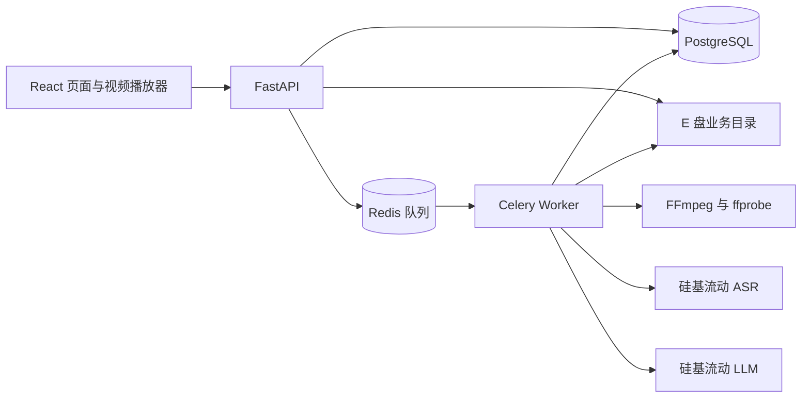

# 课程视频转写与可追溯总结平台：MVP 技术方案

> 状态：技术栈已确认，本文作为首版实施依据；具体依赖版本、模型和运行环境仍需实测。
> 更新日期：2026-09-29。
> 产品依据：[MVP 产品设计](../product/mvp.md)。产品范围与验收标准以该文档为准。

## 1. 目标、范围与约束

本项目面向中文技术课程学习，完成视频上传、语音转写、结构化总结和引用回看闭环，同时展示 Python 后端与 AI 应用工程能力。首版按可持续迭代的小型项目建设，计划投入 6 周、每周 12–15 小时。

MVP 实现账号隔离、普通流式上传、单任务分析、转写检查点、总结引用校验、手动重试和整条记录删除。分析对象为语音讲解。

画面理解、屏幕代码识别、知识问答、句级时间戳、断点续传、自动故障恢复和线上部署不在本版范围内。总结完整性和语义准确性不作为工程验收门槛。

| 约束 | 实施要求 |
| --- | --- |
| 单视频 | 时长不超过 20 分钟，文件不超过 1 GiB；服务端验证媒体有效性和音轨。 |
| 分析并发 | 仅一个 Worker 执行进程，同时处理一个视频；其他已提交任务排队。 |
| 业务容量 | 上限 5 GiB，包含原视频、上传临时文件、处理文件、数据库及队列持久化数据。 |
| 数据位置 | 持久化数据和临时业务文件位于 `E:\VideoClip\data` 下的独立目录。 |
| 模型与费用 | 优先使用硅基流动免费 ASR 和免费 LLM；付费模型切换需另行确认。 |
| Docker | 新增占用预计及实测均不超过 7 GiB 时沿用现有环境，保护已有 Docker 项目。 |
| 时间定位 | 约 30 秒的片段级区间；时间依据来自切片记录。 |

不可妥协项：用户资源隔离、成功片段可复用、缺失片段时不交付成功的全课总结、非法引用不标记成功、容量统计覆盖临时文件、删除不遗留可访问的用户数据。

## 2. 技术栈与主要决策

| 部分 | 选择 | 用途与取舍 |
| --- | --- | --- |
| 后端 | Python、FastAPI、Uvicorn | 提供鉴权、上传、任务和结果接口；耗时分析交给独立 Worker。 |
| 数据校验 | Pydantic | 定义接口与总结结构；原文匹配和时间有效性由业务代码验证。 |
| 数据库 | PostgreSQL、SQLAlchemy、Alembic | 持久化任务与检查点，提供事务、唯一约束和数据库迁移。 |
| 任务队列 | Celery、Redis | Redis 负责投递，Celery 执行分析；业务状态以 PostgreSQL 为准。 |
| 媒体工具 | FFmpeg、ffprobe | 检查媒体、提取音频、切片并记录时间范围。 |
| 模型请求 | HTTPX、硅基流动 API | 分别封装 ASR 与 LLM 请求，统一超时、错误分类和调用记录。 |
| 前端 | React、TypeScript、Vite | 实现三个页面、上传进度、状态轮询和视频回看。 |
| 本地运行 | Docker Compose、Linux 容器 | API 与 Worker 共享业务代码和镜像，分别启动。 |
| 验证工具 | pytest、Ruff、TypeScript 检查、Playwright | 验证后端行为、代码质量及关键页面交互。 |

保留 PostgreSQL 和 Celery，主要考虑任务恢复与后端工程展示；接受相应的环境配置成本。AI 流程用普通 Python 代码组织，保持模型调用、校验和错误处理直观可查。

初始化时锁定一组已验证兼容的依赖与镜像版本，提交依赖锁文件。FastAPI 与其 Starlette 依赖一起验证，尤其检查上传和视频 Range 请求；本文不把当前最新版直接作为可用版本承诺。

Celery 官方不支持原生 Windows，因此 Worker 运行在 Linux 容器中，见 [Celery 官方说明](https://docs.celeryq.dev/en/stable/getting-started/introduction.html)。

## 3. 总体结构



- API 处理请求、鉴权和任务提交，不在请求生命周期内执行整段转写或总结。
- Worker 从队列接收任务编号，从数据库读取配置并更新阶段、检查点和结果。
- PostgreSQL 保存完整业务状态；Redis 消息只传递任务编号，不存放视频或转写全文。
- 开发时由 Vite 代理 `/api`；本地演示时由 API 提供前端构建产物，保持同源访问。
- 视频通过鉴权后的文件接口读取，不将业务目录直接作为公开静态目录。

后端按账号、视频与存储、任务、转写、总结划分模块，模块共用一套数据模型。API 和 Worker 是两个运行入口，不拆成多个业务服务。

## 4. 核心数据

| 数据 | 主要内容 |
| --- | --- |
| 用户与会话 | 用户名、密码哈希、会话令牌哈希、过期时间。 |
| 视频 | 所属用户、原始文件名、受控存储路径、大小、时长、媒体信息、删除状态。 |
| 分析任务 | 视频编号、尝试编号、状态、阶段、成功片段数、错误码、起止时间、模型与提示词版本、执行标识。 |
| 转写片段 | 视频编号、切片版本、片段编号、起止时间、文本、状态、实际 ASR 模型与错误信息。 |
| 总结 | 所属视频与任务、结构版本、章节和知识要点、引用、校验结果、LLM 与提示词版本。 |
| 容量预留 | 所属上传或任务、预留类型、剩余预留量、释放状态。 |

转写片段按“视频＋切片版本＋片段编号”唯一保存。成功检查点提交数据库后才能进入下一片段；临时音频是否存在不影响转写文本的持久化。

一个视频最多存在一个待执行或执行中的分析任务，通过数据库约束与事务避免重复提交。任务状态更新和检查点写入必须校验当前执行标识，防止过期尝试回写结果。

## 5. 上传与分析流程

### 5.1 普通流式上传

1. 校验登录状态和声明大小，在接收文件内容前完成容量预留。
2. 浏览器以 XMLHttpRequest 发送原始文件请求体，展示已发送字节进度；后端使用请求流逐块写入受控的 `.part` 文件。
3. 服务端累计实际字节数，不信任声明大小、扩展名或 MIME 类型；声明与实际大小不符、超过限制或上传断开时中止并清理。
4. 上传结束后用 ffprobe 检查有效视频流、音轨、正数且有限的时长及 20 分钟上限。探测设置超时，通过参数列表调用进程。
5. 校验成功后将临时文件改名为正式文件并登记视频；文件与数据库操作失败时执行补偿清理。页面提示“上传完成”后仍需等待媒体校验结果。

原始请求流避免默认 multipart 临时落盘路径脱离容量管理，接口实现参考 [Starlette 请求流说明](https://www.starlette.dev/requests/)。服务端生成文件路径，原文件名仅作为展示元数据。

首个样本阶段确认浏览器可回看的封装与编码白名单，并在上传界面说明。ffprobe 能解析不等于浏览器能播放；本版不引入整段视频自动转码。

### 5.2 任务提交与执行

提交分析后返回任务编号，HTTP 响应使用 `202 Accepted`。任务状态采用 `queued`、`running`、`succeeded`、`failed`、`interrupted`、`cancelled`；运行阶段另行记录为音频提取、转写、总结、校验和清理。

处理步骤：

1. Worker 校验任务仍为当前有效尝试并取得数据库执行锁；唯一 Worker 的并发设为 1，预取设为 1。
2. FFmpeg 提取单声道、16 kHz、16-bit PCM 音频，按约 30 秒切分，保存实际片段编号和起止时间。
3. 顺序调用 ASR，每片完成即持久化文本和状态；最后一片按实际长度处理，不补足为 30 秒。
4. 全部片段转写成功后，按时间顺序将带编号的转写交给 LLM。
5. 执行结构、引用和时间校验，必要时进行有限修复。
6. 校验通过后保存总结并标记成功，清理本次临时音频与中间文件，释放处理预留。

数据库提交与 Redis 投递不是一个原子事务。投递失败需记录可重试错误；重启后对没有执行者的遗留任务提供中断状态与手动恢复入口，不把队列发送成功当成分析成功。重复或迟到消息需检查任务状态、执行锁和执行标识，不能重复处理已完成任务。

### 5.3 手动重试

- 重试先确认原尝试已失败，或取得执行锁确认旧执行者已退出；不能仅凭心跳超时启动第二个执行者。
- 使旧尝试失效，创建新的分析尝试，沿用原切片和 ASR 配置。
- 复用已成功的转写，只重建并转写失败或未完成片段；总结阶段失败时直接复用完整转写。
- 临时目录按尝试隔离，旧尝试不能覆盖新尝试的文件或结果。
- 限流、网络超时、模型不可用或 Worker 中断均展示明确原因；本版由用户手动重试，不持续自动调用模型。

## 6. 模型接入、总结与引用校验

### 6.1 先验证接口能力

实施起点为一段 1–3 分钟真实课程样本，验证音频上传、中文转写、总结 JSON 和引用匹配。模型名通过配置提供，不在业务逻辑中写死。

ASR 文档目前提供文本响应，片段起止时间由切片记录维护，见 [硅基流动 ASR 接口](https://docs.siliconflow.cn/docs/api/audio-transcriptions-post)。对话接口能力参考 [硅基流动 LLM 接口](https://docs.siliconflow.cn/docs/api/chat-completions-post)，JSON 输出方式需逐模型实测。

样本验证需记录：实际可用的免费模型、音频规格、请求耗时、限流表现、中文技术术语表现和输出结构。同时确认模型上下文能容纳 20 分钟课程规模的转写、提示词及预期输出。不能通过截断全文或付费调用静默绕过约束；免费能力不满足时记录阻塞与取舍。

每次请求设置连接和读取超时，分类记录鉴权、限流、服务异常及输出错误。记录任务编号、模型、提示词版本、耗时和供应商追踪编号，不在普通日志输出密钥或转写全文。

### 6.2 输出与校验

总结包含章节大纲和知识要点，两者均携带原文引用。每条引用至少包含 `segment_index` 和 `quote`；跨片段内容使用多条引用。章节与引用的展示时间由服务端根据片段记录计算，避免让模型生成时间事实。

校验顺序：

1. **结构校验**：用 Pydantic 验证必填字段、类型、非空内容和集合限制，拒绝未知字段。
2. **片段校验**：引用必须指向当前视频、当前切片版本下已成功的片段。
3. **原文匹配**：引用必须是对应文本的连续子串；仅允许明确定义的 Unicode 和空白规范化，不做模糊匹配或改写后匹配。
4. **时间校验**：所有区间满足 `0 <= start < end <= video_duration`；章节区间由其引用片段推导，输出数值需为有限值。
5. **完整性校验**：预期片段全部成功、章节和知识要点有有效引用后，才允许任务标记成功。

首次输出失败时，带具体错误反馈最多修复 2 次，总计最多 3 次总结请求。仍不合法则标记失败，保留转写和受容量限制的诊断记录供手动重试。半成品不作为成功总结展示。

这些校验验证来源与定位，不证明总结结论在语义上正确。结构定义可参考 [Pydantic 模型文档](https://docs.pydantic.dev/latest/concepts/models/)。

## 7. 鉴权、接口与页面

采用服务端会话：密码保存 Argon2id 哈希；浏览器保存随机会话令牌 Cookie，数据库保存令牌哈希及过期时间。Cookie 设置 `HttpOnly` 和 `SameSite`；本地 HTTP 使用明确的开发配置，HTTPS 环境启用 `Secure`。退出登录同时使服务端会话失效。

同源访问下，状态变更接口检查 Origin 并校验 CSRF 令牌。所有视频、任务、转写、总结和媒体接口都检查所属用户；资源编号不可替代权限校验，其他账号访问统一返回不可见结果。

| 接口组 | 主要操作 |
| --- | --- |
| `/api/auth` | 注册、登录、当前用户、退出。 |
| `/api/videos` | 上传、列表、详情、整条记录删除。 |
| `/api/videos/{id}/tasks` | 提交分析、创建手动重试尝试。 |
| `/api/tasks/{id}` | 查询状态、阶段、成功片段数、总片段数、错误原因。 |
| `/api/videos/{id}/transcript`、`/summary` | 获取有权限访问的转写和已校验总结。 |
| `/api/videos/{id}/content` | 鉴权后读取视频，支持字节 Range 和 HEAD 请求。 |

错误响应包含稳定错误码、可读原因和是否可重试，隐藏本机绝对路径及密钥。未完成的总结返回明确状态，前端据此显示进度或错误。

前端实现注册／登录、视频列表、视频详情三个页面。处理期间每约 2 秒轮询任务，进入终态后停止；展示阶段与片段数量，不以虚构百分比表示模型调用耗时。

播放器使用原生 `<video>`，点击引用设置 `currentTime` 为片段起点并播放。媒体接口先鉴权再使用支持 Range 的文件响应，验证 `206`、`416` 和浏览器实际跳转，参考 [Starlette 文件响应](https://www.starlette.dev/responses/)。会话 Cookie 使播放器请求能够沿用登录鉴权。

## 8. 存储、容量与删除

建议的数据目录：

```text
E:\VideoClip\data\
  videos\       原视频，按用户和视频编号组织
  uploads\      上传中的 .part 文件
  work\         按任务尝试隔离的音频及中间文件
  postgres\     数据库持久化目录，包含 WAL
  redis\        队列持久化目录
```

实现时将业务数据、密钥和临时文件排除出 Git。API、Worker 与相应基础服务通过明确的挂载访问各自目录，业务文件不得落入默认系统临时目录或容器可写层。

### 8.1 容量控制

- 统一容量管理负责“实际占用＋尚未兑现的预留量”，包含 PostgreSQL、Redis 及处理中间文件；并发上传的准入通过数据库锁串行判断。
- 上传前预留声明大小和处理峰值预算；写入后将预留逐步转为实际占用，不能重复计算或提前释放尚需使用的空间。声明大小缺失时按最大文件预算预留。
- 20 分钟的上述 PCM 音频约 36.6 MiB；完整音频与切片各保留一份时约 73.2 MiB。处理预算初始取 128 MiB，并结合数据库、WAL 增长余量和实测峰值校准，不能把音频估算作为全部占用。
- 上传和处理均不得突破自身预留；持续检查业务占用与宿主机可用空间，空间不足时停止产生新文件、记录错误并清理。
- 数据库增长余量、Redis 持久化峰值和磁盘统计方式需在环境验证阶段确认；验收核对实际业务目录占用，而非仅累加已登记视频大小。
- 达到容量限制时停止新上传并提示删除记录；队列投递只包含编号，诊断记录限制大小和保留量。

### 8.2 删除与临时文件回收

删除先持久化删除状态，立即禁止该记录的分析、重试与媒体访问。排队任务失效；执行中的任务在安全边界停止，确认无执行者后再清理文件和关联转写、任务、总结。正在停止或清理时返回 `202` 并显示删除进度，清理全部成功后才视为删除完成。

文件删除与数据库事务不能原子提交，需保留可重入的清理状态。清理失败不能提前丢失文件路径或释放容量；用户再次删除或启动时清理遗留项。启动清理只处理已确认无人使用的上传临时文件和任务临时目录，不误删原视频或运行中的文件。

完成、失败或取消任务都执行本次临时文件清理，Worker 崩溃留下的文件由启动检查回收。释放容量以实际占用为准；删除数据库记录不意味着数据库文件立即缩小，见 [PostgreSQL 空间回收说明](https://www.postgresql.org/docs/current/routine-vacuuming.html)。

## 9. 本地运行与环境验证

Docker Compose 运行 API、Worker、PostgreSQL 和 Redis；API 与 Worker 共用包含 FFmpeg 的精简镜像，前端仅保留构建产物进入演示镜像。宿主机只向回环地址开放必要端口。

PostgreSQL 和 Redis 的持久化路径需明确映射到 E 盘业务目录，参考 [Docker bind mount 说明](https://docs.docker.com/engine/storage/bind-mounts/)。先验证 Windows 路径挂载、数据库初始化权限、容器重启后的持久化与备份恢复；不能静默改用位于默认 Docker 存储区的数据库卷来绕过路径要求。

环境准备先记录已有项目、镜像和磁盘占用基线，设置容器日志轮转。新增占用包含镜像、构建缓存、容器可写层和日志；使用 [docker system df](https://docs.docker.com/reference/cli/docker/system/df/) 配合容器日志及实际宿主机占用检查，不能只凭镜像大小判断。演示记录同时覆盖一次构建与真实处理后的峰值。

若新增占用超过 7 GiB，或 E 盘数据库挂载验证失败，先提出精简或迁移方案，不擅自迁移全局 Docker 数据或清理其他项目。需要全局迁移时，必须安排现有项目基线检查、备份、回滚与运行验证。

## 10. 实施阶段与验收

| 阶段 | 计划 | 可独立验证的交付 |
| --- | --- | --- |
| 1. 能力与环境验证 | 第 1 周 | 1–3 分钟样本跑通真实 ASR、LLM 和引用校验；确认免费模型能力、上下文预算、E 盘持久化和 Docker 占用。 |
| 2. 后端基础 | 第 2 周 | 账号隔离、数据库迁移、流式上传、媒体校验、容量预留；边界与越权测试通过。 |
| 3. 可恢复分析 | 第 3 周 | 单 Worker、任务状态、切片转写检查点和手动重试；已成功片段不重复调用 ASR。 |
| 4. 总结与校验 | 第 4 周 | 章节与知识要点、引用校验、有限修复；缺失转写及非法输出不能标记成功。 |
| 5. 页面闭环 | 第 5 周 | 三个页面、上传和分析进度、鉴权播放、引用跳转、整条记录删除。 |
| 6. 验收与展示 | 第 6 周 | 真实课程闭环、限制与故障演示、完整检查及复现说明。 |

模型和环境验证未通过时，先解决阻塞再扩大开发范围。每个逻辑完整的改动单元同步完成直接相关测试与 Conventional Commits 提交，测试成本计入上述时间。

验证覆盖：

- **单元测试**：片段边界、任务状态转换、引用规范化与匹配、时间区间、输出修复次数、容量预留释放。
- **集成测试**：真实 PostgreSQL 约束、双账号资源隔离、重复提交与迟到消息、断开上传、无音轨、超限文件、手动恢复复用检查点、取消与删除竞态、遗留文件清理。
- **页面验收**：上传进度、轮询终止、错误与重试入口、Cookie 鉴权下的 Range 播放、引用跳转和删除状态。
- **真实模型验收**：至少一段课程完成真实 ASR 与 LLM 流程；记录实际模型、提示词版本、耗时和引用校验结果。模拟接口测试不能替代此项。
- **资源验收**：验证 1 GiB、20 分钟、单分析并发、5 GiB 业务容量及 7 GiB Docker 预算；检查处理中间文件峰值、删除后的实际占用和容器重启行为。
- **工程检查**：每次先运行直接相关测试；跨模块交付运行完整后端测试、前端构建、lint 和类型检查，保存可复现命令及结果。

## 11. 当前进度、待验证项与下一步

| 项目 | 当前结果 |
| --- | --- |
| 产品范围与主技术栈 | 已确认。 |
| 技术方案 | 已形成本文，作为首版实施依据。 |
| 文档静态检查 | 编码、代码块闭合、产品文档链接和关键约束检查通过。 |
| 上游能力资料 | 已核对 Celery 平台支持、请求流、文件 Range、模型接口和 Docker 存储文档。 |
| 依赖与环境 | 尚未安装、构建或验证；Docker 新增占用尚未测量。 |
| 模型能力 | 尚未真实调用；免费可用性、上下文、质量和限流均待实测。 |
| 业务与页面验收 | 尚未实施，未运行相关测试。 |

下一步先执行第 1 阶段，将实际模型、已验证依赖版本、环境占用和验证结果补充到本文。产品边界需要调整时同步更新产品文档。

MVP 完成后再迭代分片上传、自动恢复与限流等待、删除原视频但保留笔记，以及更完整的故障执行记录。
